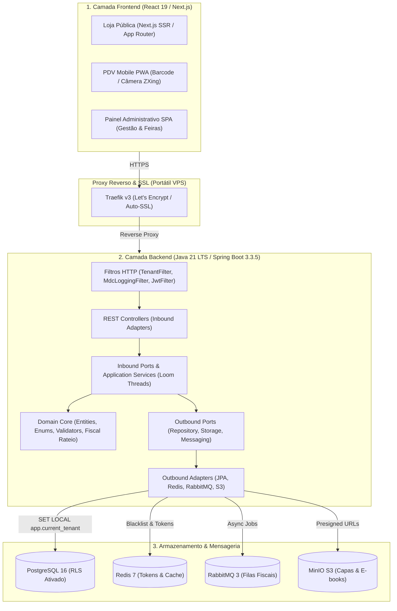
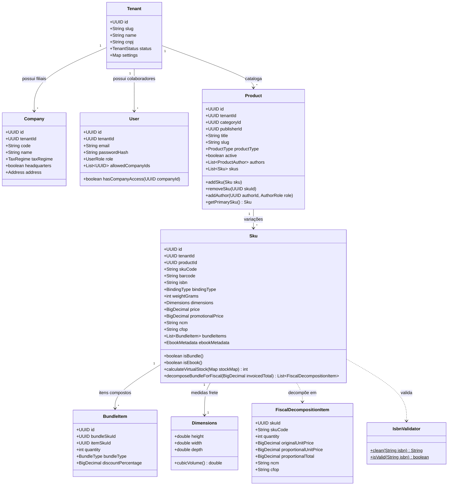
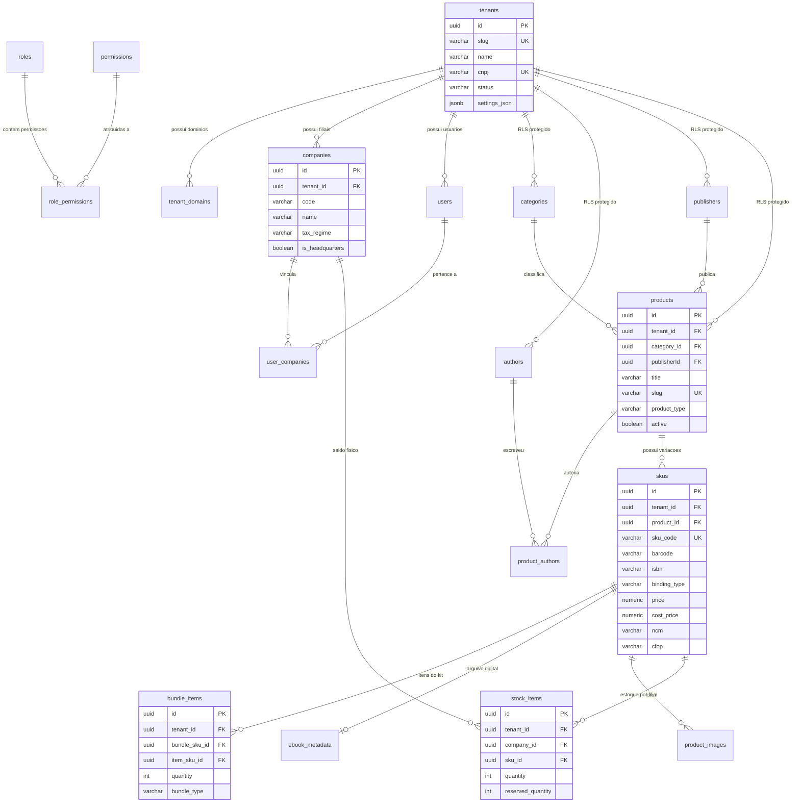
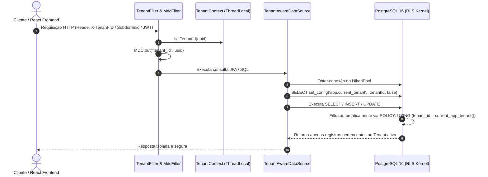
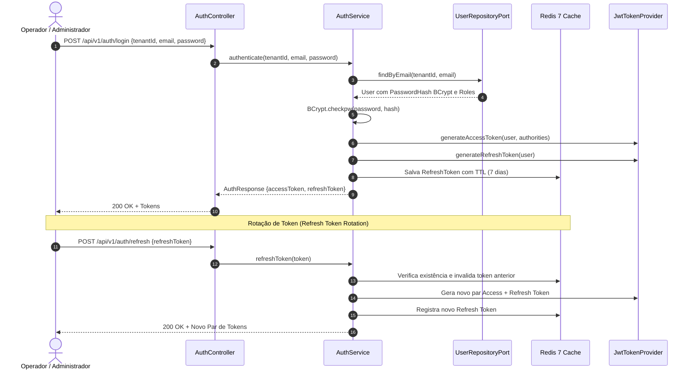
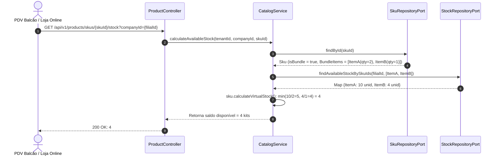
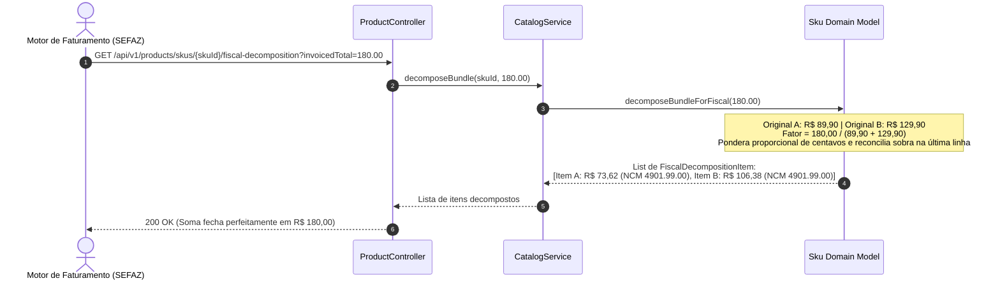
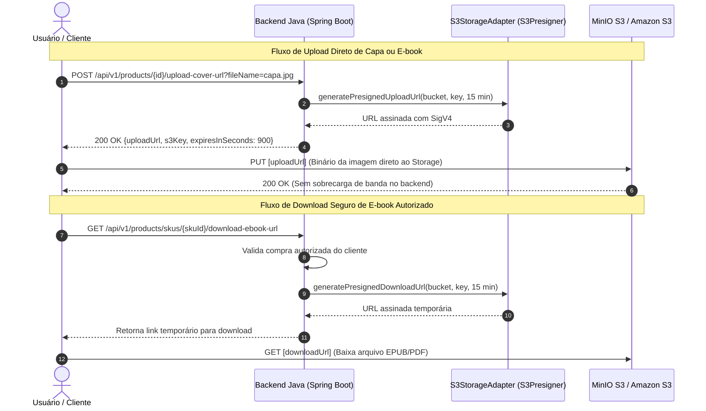

# Especificação Arquitetural e de Engenharia de Software

Este documento consolida a arquitetura técnica, modelagem de dados, diagramas UML em Mermaid, catálogo de endpoints e fluxos operacionais da **Plataforma de E-commerce, PDV e Gestão Multi-Tenant**.

Para a documentação web interativa com renderização dinâmica, acesse o endpoint:
👉 `http://localhost:8080/docs` (ou `/documentation`)

---

## 1. Visão Geral da Arquitetura (3 Camadas)

A plataforma substitui o ecossistema monolítico legado WordPress/WooCommerce por uma arquitetura moderna, desacoplada (Headless), orientada a eventos e baseada nos princípios da **Clean Architecture (Hexagonal)** com suporte nativo a **Virtual Threads (Project Loom)** no Java 21 LTS e isolamento estrito de múltiplos lojistas via **Row-Level Security (RLS)** no PostgreSQL 16.



---

## 2. Diagrama de Classes de Domínio (UML Class Diagram)

O domínio da aplicação é desacoplado de anotações de persistência ou de frameworks (DDD/Clean Architecture).



---

## 3. Diagrama Entidade-Relacionamento (ER) & Row-Level Security

Todas as tabelas do catálogo e cadastros transacionais utilizam isolamento multitenant forçado (`FORCE ROW LEVEL SECURITY`). O acesso direto aos dados sem definir a variável de sessão `app.current_tenant` resulta em retorno vazio.



---

## 4. Diagramas de Sequência dos Fluxos Principais

### 4.1. Resolução de Multi-Tenancy e Injeção de RLS no HikariCP

Garante a segurança de isolamento antes de qualquer consulta SQL.



---

### 4.2. Autenticação JWT, Resolução RBAC e Rotação de Tokens via Redis



---

### 4.3. Estoque Virtual Dinâmico para Kits & Combos

A disponibilidade é calculada sob demanda com base no menor saldo disponível entre os itens constituintes:

$$\text{Saldo Virtual} = \min_{i \in \text{Itens}} \left( \left\lfloor \frac{\text{Saldo Disponível}_i}{\text{Quantidade Necessária}_i} \right\rfloor \right)$$



---

### 4.4. Motor de Rateio e Decomposição Fiscal de Kits para NF-e/NFC-e

Calcula a proporção exata de cada item no preço final faturado do combo, preservando NCM e CFOP e reconciliando centavos de dízimas periódicas:



---

### 4.5. Importação em Lote via Streaming com Rollback Isolado

Suporta arquivos de até 50.000 livros em chunks de 500 registros utilizando Apache POI e Commons CSV:


---

### 4.6. Upload e Download Seguro via Presigned URLs (MinIO S3 / AWS S3)



---

## 5. Catálogo Completo de Endpoints REST

| Método | Endpoint | Permissão RBAC | Descrição |
| :--- | :--- | :--- | :--- |
| **GET** | `/api/v1/health` | Pública | Verificação de integridade e Virtual Threads ativas |
| **GET** | `/docs` | Pública | Portal HTML interativo de documentação e diagramas UML |
| **GET** | `/api/v1/auth/tenant-info` | Pública | Resolução visual do Tenant para a tela de login |
| **POST** | `/api/v1/auth/login` | Pública | Autenticação com retorno de Access e Refresh Tokens |
| **POST** | `/api/v1/auth/refresh` | Pública | Rotação de Refresh Token via Redis |
| **POST** | `/api/v1/auth/logout` | Autenticado | Invalidação e inclusão de token na blacklist do Redis |
| **POST** | `/api/v1/tenants` | `SUPER_ADMIN` | Cadastro de novo Tenant |
| **GET** | `/api/v1/tenants/{id}` | `SUPER_ADMIN` | Buscar Tenant por ID |
| **GET** | `/api/v1/tenants/slug/{slug}` | `SUPER_ADMIN` | Buscar Tenant pelo slug |
| **POST** | `/api/v1/companies` | `TENANT_ADMIN` | Cadastrar filial ou stand de feira |
| **GET** | `/api/v1/companies/{id}` | Autenticado | Buscar filial por ID |
| **GET** | `/api/v1/companies/code/{code}` | Autenticado | Buscar filial por código (ex: MATRIZ) |
| **GET** | `/api/v1/companies` | Autenticado | Listar todas as filiais do Tenant |
| **POST** | `/api/v1/users` | `USER_MANAGE` | Criar usuário e atribuir permissões e filiais |
| **GET** | `/api/v1/users/me` | Autenticado | Consultar perfil e authorities do usuário logado |
| **GET** | `/api/v1/users/{id}` | `USER_MANAGE` | Buscar colaborador por ID |
| **PUT** | `/api/v1/users/{id}` | `USER_MANAGE` | Atualizar dados do colaborador |
| **PUT** | `/api/v1/users/{id}/password` | `USER_MANAGE` | Redefinição de senha com BCrypt |
| **PATCH**| `/api/v1/users/{id}/status` | `USER_MANAGE` | Bloquear ou desbloquear colaborador |
| **POST** | `/api/v1/taxonomy/categories` | `CATALOG_WRITE`| Criar categoria de produto |
| **GET** | `/api/v1/taxonomy/categories` | Pública | Listar categorias do Tenant |
| **POST** | `/api/v1/taxonomy/authors` | `CATALOG_WRITE`| Cadastrar autor |
| **GET** | `/api/v1/taxonomy/authors` | Pública | Listar autores |
| **POST** | `/api/v1/taxonomy/publishers` | `CATALOG_WRITE`| Cadastrar editora |
| **GET** | `/api/v1/taxonomy/publishers` | Pública | Listar editoras |
| **POST** | `/api/v1/products` | `CATALOG_WRITE`| Criar Produto Pai com SKUs iniciais opcionais |
| **PUT** | `/api/v1/products/{id}` | `CATALOG_WRITE`| Atualizar metadados do Produto Pai |
| **GET** | `/api/v1/products/{id}` | Pública | Buscar produto completo por ID |
| **GET** | `/api/v1/products/slug/{slug}` | Pública | Buscar produto pelo slug amigável (Loja Pública) |
| **GET** | `/api/v1/products` | Pública | Pesquisar produtos com filtros facetados e paginação |
| **DELETE**| `/api/v1/products/{id}` | `CATALOG_WRITE`| Remover produto e SKUs |
| **POST** | `/api/v1/products/{id}/skus` | `CATALOG_WRITE`| Adicionar SKU/Variação ao produto |
| **PUT** | `/api/v1/products/skus/{skuId}`| `CATALOG_WRITE`| Atualizar variação |
| **GET** | `/api/v1/products/skus/{skuId}`| Pública | Buscar SKU por ID |
| **GET** | `/api/v1/products/skus/barcode/{barcode}`| Pública | Buscar SKU por código de barras (EAN-13) |
| **GET** | `/api/v1/products/skus/isbn/{isbn}`| Pública | Buscar SKU por ISBN (ISBN-10 ou ISBN-13) |
| **DELETE**| `/api/v1/products/skus/{skuId}`| `CATALOG_WRITE`| Remover variação |
| **GET** | `/api/v1/products/skus/{skuId}/stock`| Pública | Saldo de estoque (calcula estoque virtual para kits) |
| **GET** | `/api/v1/products/skus/{skuId}/fiscal-decomposition`| Pública | Decomposição e rateio proporcional de kit para NF-e/NFC-e |
| **POST** | `/api/v1/products/{id}/upload-cover-url`| `CATALOG_WRITE`| Gerar presigned URL no S3 para upload de capa |
| **POST** | `/api/v1/products/skus/{skuId}/upload-ebook-url`| `CATALOG_WRITE`| Gerar presigned URL no S3 para upload de e-book |
| **GET** | `/api/v1/products/skus/{skuId}/download-ebook-url`| Autenticado | Link temporário de 15 minutos para download de e-book |
| **POST** | `/api/v1/products/import` | `CATALOG_WRITE`| Importação em streaming de XLSX/CSV com rollback isolado |

---

## 6. Portabilidade Twelve-Factor e Deploy

O backend é agnóstico a provedor e permite deploy direto via Docker Compose ou migração elástica para Amazon Web Services:

```bash
# Execução local / Desenvolvimento
docker compose up -d

# Execução em VPS de Produção (com Traefik e Let's Encrypt)
docker compose -f docker-compose.vps.yml up -d

# Rotina de Backup Automatizado do PostgreSQL (com rotação de 7 dias)
./scripts/backup-postgres.sh
```

