# Especificação Arquitetural e de Engenharia de Software

Este documento consolida a arquitetura técnica, estrutura hexagonal de pastas, modelagem de dados, diagramas UML (Classes, Entidade-Relacionamento e Sequência), catálogo completo de endpoints REST e diretrizes de infraestrutura da **Plataforma de E-commerce, PDV e Gestão Multi-Tenant**.

Para a documentação web interativa e viva com renderização dinâmica e ferramentas de zoom/pan, acesse:
👉  (ou )

---

## 1. Visão Geral da Arquitetura & Diagramas UML

O sistema adota o padrão **Clean Architecture / Arquitetura Hexagonal (Ports & Adapters)** com **Java 21 LTS** e **Project Loom (Virtual Threads)** ativadas nativamente para altíssima concorrência I/O:

```
src/main/java/com/livraria/ecommerce/
├── domain/                    # Núcleo de regras de negócio puras (sem dependência de frameworks)
│   ├── model/                 # Entidades e Value Objects (Tenant, User, Product, Sku, etc.)
│   ├── port/in/               # Use Cases / Portas de Entrada (CatalogUseCase, BatchImportUseCase, etc.)
│   ├── port/out/              # Portas de Saída (Repositórios, Storage, Mensageria)
│   └── exception/             # Exceções de Domínio e Negócio
├── application/               # Serviços de Aplicação e Orquestração
│   ├── service/               # Implementação dos Use Cases (CatalogService, BatchImportService, etc.)
│   └── dto/                   # DTOs de comando e transferência
└── infrastructure/            # Adaptadores de Tecnologia e Frameworks
    ├── adapters/in/web/       # Controllers REST, Filtros (Tenant, MDC Logging), Exception Handlers e /docs
    ├── adapters/out/          # Implementações das Portas de Saída:
    │   ├── persistence/       # PostgreSQL com Row-Level Security (RLS) e HikariCP Tenant Aware
    │   └── storage/           # AWS SDK v2 (S3 nativo e MinIO local compatível com presigned URLs)
    ├── config/                # Configurações Spring (Segurança, OpenAPI, RabbitMQ, Redis, DataSource)
    └── security/              # Autenticação JWT, UserPrincipal e Filtros de Segurança
```

### 1.1. Diagrama de Arquitetura em 3 Camadas

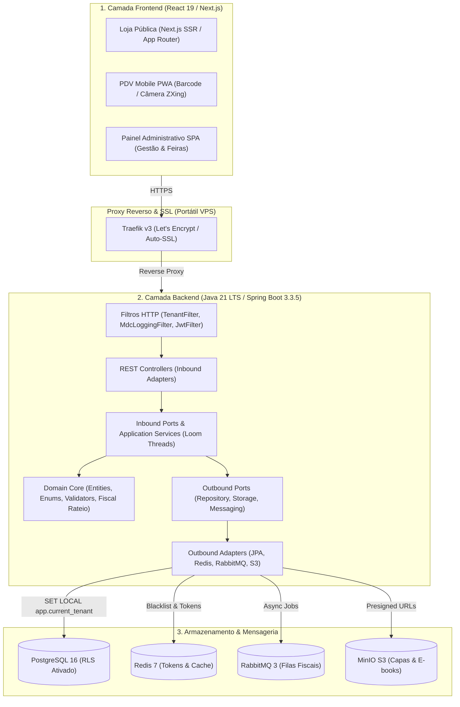

### 1.2. Diagrama de Classes de Domínio (UML Class Diagram)

O diagrama abaixo ilustra o núcleo de domínio, com separação de Produto Pai, Variações (SKUs), Composição de Kits Virtuais/Físicos e Validação de ISBN:

```mermaid
classDiagram
    class Tenant {
        +UUID id
        +String slug
        +String name
        +String cnpj
        +TenantStatus status
        +Map settings
    }

    class Company {
        +UUID id
        +UUID tenantId
        +String code
        +String name
        +TaxRegime taxRegime
        +boolean headquarters
        +Address address
    }

    class User {
        +UUID id
        +UUID tenantId
        +String email
        +String passwordHash
        +UserRole role
        +List~UUID~ allowedCompanyIds
        +boolean hasCompanyAccess(UUID companyId)
    }

    class Product {
        +UUID id
        +UUID tenantId
        +UUID categoryId
        +UUID publisherId
        +String title
        +String slug
        +ProductType productType
        +boolean active
        +List~ProductAuthor~ authors
        +List~Sku~ skus
        +addSku(Sku sku)
        +removeSku(UUID skuId)
        +addAuthor(UUID authorId, AuthorRole role)
        +getPrimarySku() Sku
    }

    class Sku {
        +UUID id
        +UUID tenantId
        +UUID productId
        +String skuCode
        +String barcode
        +String isbn
        +BindingType bindingType
        +int weightGrams
        +Dimensions dimensions
        +BigDecimal price
        +BigDecimal promotionalPrice
        +String ncm
        +String cfop
        +List~BundleItem~ bundleItems
        +EbookMetadata ebookMetadata
        +boolean isBundle()
        +boolean isEbook()
        +calculateVirtualStock(Map stockMap) int
        +decomposeBundleForFiscal(BigDecimal invoicedTotal) List~FiscalDecompositionItem~
    }

    class BundleItem {
        +UUID id
        +UUID bundleSkuId
        +UUID itemSkuId
        +int quantity
        +BundleType bundleType
        +BigDecimal discountPercentage
    }

    class Dimensions {
        +double height
        +double width
        +double depth
        +cubicVolume() double
    }

    class IsbnValidator {
        +clean(String isbn)$ String
        +isValid(String isbn)$ boolean
    }

    class FiscalDecompositionItem {
        +UUID skuId
        +String skuCode
        +int quantity
        +BigDecimal originalUnitPrice
        +BigDecimal proportionalUnitPrice
        +BigDecimal proportionalTotal
        +String ncm
        +String cfop
    }

    class StockTransfer {
        +UUID id
        +UUID tenantId
        +String transferNumber
        +UUID originCompanyId
        +UUID destinationCompanyId
        +TransferStatus status
        +TransferType transferType
        +List~StockTransferItem~ items
        +dispatch(UUID dispatchedBy)
        +receive(Map quantities, UUID receivedBy)
        +calculateTotalItems() int
        +calculateTotalValue() BigDecimal
    }

    class StockTransferItem {
        +UUID id
        +UUID skuId
        +String skuCode
        +int quantityRequested
        +int quantityDispatched
        +int quantityReceived
        +int getDivergence()
        +BigDecimal unitPrice
    }

    class StockMovement {
        +UUID id
        +UUID tenantId
        +UUID companyId
        +UUID skuId
        +MovementType movementType
        +int quantityChange
        +int balanceAfter
        +UUID referenceId
        +String reason
    }

    class BlindAudit {
        +UUID id
        +UUID tenantId
        +UUID companyId
        +String code
        +AuditStatus status
        +List~BlindAuditItem~ items
        +scanBarcode(UUID skuId, int count)
        +finalizeAudit()
        +reconcile()
        +getTotalDivergence() int
    }

    class BlindAuditItem {
        +UUID id
        +UUID skuId
        +int quantityScanned
        +int quantityExpected
        +int divergence
        +incrementScanned(int count)
    }

    class CashShift {
        +UUID id
        +UUID tenantId
        +UUID companyId
        +UUID cashierId
        +String shiftNumber
        +ShiftStatus status
        +BigDecimal openingBalance
        +BigDecimal expectedBalance
        +BigDecimal actualBalance
        +BigDecimal divergence
        +addSupply(BigDecimal amount, String reason)
        +addBleed(BigDecimal amount, String reason)
        +recordSalePayment(BigDecimal amount, PaymentMethod method)
        +closeBlind(BigDecimal countedCash, String notes)
    }

    class CashMovement {
        +UUID id
        +UUID shiftId
        +CashMovementType movementType
        +BigDecimal amount
        +PaymentMethod paymentMethod
        +String reason
    }

    class PosSale {
        +UUID id
        +UUID companyId
        +UUID shiftId
        +String saleNumber
        +UUID clientUuid
        +BigDecimal subtotal
        +BigDecimal discount
        +BigDecimal total
        +BigDecimal totalPaid
        +BigDecimal changeAmount
        +SaleStatus status
        +String nfceKey
        +NfceStatus nfceStatus
        +cancel()
    }

    class PosSaleItem {
        +UUID id
        +UUID skuId
        +int quantity
        +BigDecimal unitPrice
        +BigDecimal discount
        +BigDecimal subtotal
    }

    class PosSalePayment {
        +UUID id
        +PaymentMethod paymentMethod
        +BigDecimal amount
    }

    class Cart {
        +UUID id
        +UUID tenantId
        +String sessionId
        +UUID customerId
        +List~CartItem~ items
        +addItem(UUID skuId, int qty, BigDecimal price)
        +updateItemQuantity(UUID skuId, int qty)
        +removeItem(UUID skuId)
        +clear()
        +calculateSubtotal() BigDecimal
        +calculateTotalItems() int
    }

    class CartItem {
        +UUID id
        +UUID skuId
        +String skuCode
        +String productTitle
        +int quantity
        +BigDecimal unitPrice
        +getTotal() BigDecimal
    }

    class Order {
        +UUID id
        +UUID tenantId
        +String orderNumber
        +OrderStatus status
        +BigDecimal subtotal
        +BigDecimal discount
        +BigDecimal shippingAmount
        +BigDecimal totalAmount
        +ShippingCarrier shippingCarrier
        +ShippingService shippingService
        +String trackingCode
        +ShippingAddress shippingAddress
        +List~OrderItem~ items
        +List~OrderPayment~ payments
        +markAsPaid(String transactionId)
        +markAsInvoiced(LocalDate dueDate)
        +ship(String trackingCode, String trackingUrl)
        +deliver()
        +cancel(String reason)
    }

    class OrderItem {
        +UUID id
        +UUID skuId
        +String skuCode
        +String productTitle
        +int quantity
        +BigDecimal unitPrice
        +BigDecimal discount
        +BigDecimal total
    }

    class OrderPayment {
        +UUID id
        +EcommercePaymentMethod paymentMethod
        +PaymentGateway gateway
        +String gatewayTransactionId
        +PaymentStatus status
        +BigDecimal amount
        +int installments
        +String pixQrCode
        +String pixCopiaCola
        +String boletoBarcode
        +String boletoUrl
        +LocalDate boletoDueDate
        +markAsPaid(String transactionId)
    }

    class CorporateBudget {
        +UUID id
        +UUID tenantId
        +String budgetNumber
        +String corporateName
        +String cnpj
        +BudgetStatus status
        +BigDecimal totalAmount
        +int paymentTermsDays
        +LocalDate dueDate
        +submitForApproval()
        +approve(boolean hasOverdueInvoices)
        +reject(String reason)
        +markAsInvoiced(UUID orderId)
    }

    class CorporateBudgetItem {
        +UUID id
        +UUID skuId
        +String skuCode
        +String productTitle
        +int quantity
        +BigDecimal unitPrice
        +BigDecimal total
    }

    Tenant "1" --> "*" Company : possui filiais
    Tenant "1" --> "*" User : possui colaboradores
    Tenant "1" --> "*" Product : cataloga
    Tenant "1" --> "*" Cart : carrinhos
    Tenant "1" --> "*" Order : pedidos e-commerce
    Tenant "1" --> "*" CorporateBudget : orçamentos corporativos
    Cart "1" --> "*" CartItem : itens do carrinho
    Order "1" --> "*" OrderItem : itens faturados
    Order "1" --> "*" OrderPayment : parcelas e gateways
    CorporateBudget "1" --> "*" CorporateBudgetItem : itens orçados
    CorporateBudget ..> Order : faturado em
    Product "1" --> "*" Sku : variações
    Sku "1" --> "*" BundleItem : itens compostos
    Sku "1" --> "1" Dimensions : medidas frete
    Sku ..> FiscalDecompositionItem : decompõe em
    Sku ..> IsbnValidator : valida
    Company "1" --> "*" StockTransfer : remessas
    StockTransfer "1" --> "*" StockTransferItem : itens
    Company "1" --> "*" StockMovement : ledger
    Company "1" --> "*" BlindAudit : auditorias de retorno
    BlindAudit "1" --> "*" BlindAuditItem : contagens bipadas
    Company "1" --> "*" CashShift : turnos de caixa
    CashShift "1" --> "*" CashMovement : suprimentos / sangrias
    CashShift "1" --> "*" PosSale : vendas vinculadas
    PosSale "1" --> "*" PosSaleItem : itens vendidos
    PosSale "1" --> "*" PosSalePayment : múltiplos pagamentos
```

### 1.3. Diagrama Entidade-Relacionamento (ER) com Row-Level Security

Todas as tabelas de escopo do lojista possuem `tenant_id` e políticas ativas com `FORCE ROW LEVEL SECURITY`:

```mermaid
erDiagram
    tenants ||--o{ tenant_domains : "possui dominios"
    tenants ||--o{ companies : "possui filiais"
    tenants ||--o{ users : "possui usuarios"
    companies ||--o{ user_companies : "vincula"
    users ||--o{ user_companies : "pertence a"
    roles ||--o{ role_permissions : "contem permissoes"
    permissions ||--o{ role_permissions : "atribuidas a"

    tenants ||--o{ categories : "RLS protegido"
    tenants ||--o{ authors : "RLS protegido"
    tenants ||--o{ publishers : "RLS protegido"
    tenants ||--o{ products : "RLS protegido"
    categories ||--o{ products : "classifica"
    publishers ||--o{ products : "publica"
    products ||--o{ product_authors : "autoria"
    authors ||--o{ product_authors : "escreveu"

    products ||--o{ skus : "possui variacoes"
    skus ||--o{ bundle_items : "itens do kit"
    skus ||--o| ebook_metadata : "arquivo digital"
    skus ||--o{ product_images : "fotos"
    companies ||--o{ stock_items : "saldo fisico"
    skus ||--o{ stock_items : "estoque por filial"

    tenants {
        uuid id PK
        varchar slug UK
        varchar name
        varchar cnpj UK
        varchar status
        jsonb settings_json
    }

    companies {
        uuid id PK
        uuid tenant_id FK
        varchar code
        varchar name
        varchar tax_regime
        boolean is_headquarters
    }

    products {
        uuid id PK
        uuid tenant_id FK
        uuid category_id FK
        uuid publisherId FK
        varchar title
        varchar slug UK
        varchar product_type
        boolean active
    }

    skus {
        uuid id PK
        uuid tenant_id FK
        uuid product_id FK
        varchar sku_code UK
        varchar barcode
        varchar isbn
        varchar binding_type
        numeric price
        numeric cost_price
        varchar ncm
        varchar cfop
    }

    bundle_items {
        uuid id PK
        uuid tenant_id FK
        uuid bundle_sku_id FK
        uuid item_sku_id FK
        int quantity
        varchar bundle_type
    }

    stock_items {
        uuid id PK
        uuid tenant_id FK
        uuid company_id FK
        uuid sku_id FK
        int quantity
        int reserved_quantity
    }

    stock_transfers {
        uuid id PK
        uuid tenant_id FK
        varchar transfer_number UK
        uuid origin_company_id FK
        uuid destination_company_id FK
        varchar status
        varchar transfer_type
        timestamp dispatched_at
        timestamp received_at
    }

    stock_transfer_items {
        uuid id PK
        uuid tenant_id FK
        uuid transfer_id FK
        uuid sku_id FK
        int quantity_requested
        int quantity_dispatched
        int quantity_received
        numeric unit_cost
        numeric unit_price
    }

    stock_movements {
        uuid id PK
        uuid tenant_id FK
        uuid company_id FK
        uuid sku_id FK
        varchar movement_type
        int quantity_change
        int balance_after
        uuid reference_id
        timestamp created_at
    }

    blind_audits {
        uuid id PK
        uuid tenant_id FK
        uuid company_id FK
        uuid transfer_id FK
        varchar code UK
        varchar status
        uuid auditor_id
        timestamp completed_at
    }

    blind_audit_items {
        uuid id PK
        uuid tenant_id FK
        uuid audit_id FK
        uuid sku_id FK
        int quantity_scanned
        int quantity_expected
        int divergence
    }

    cash_shifts {
        uuid id PK
        uuid tenant_id FK
        uuid company_id FK
        uuid cashier_id FK
        varchar shift_number UK
        varchar status
        numeric opening_balance
        numeric expected_balance
        numeric actual_balance
        numeric divergence
        timestamp opened_at
        timestamp closed_at
    }

    cash_movements {
        uuid id PK
        uuid tenant_id FK
        uuid shift_id FK
        varchar movement_type
        numeric amount
        varchar payment_method
        varchar reason
        timestamp created_at
    }

    pos_sales {
        uuid id PK
        uuid tenant_id FK
        uuid company_id FK
        uuid shift_id FK
        varchar sale_number UK
        uuid client_uuid UK
        numeric subtotal
        numeric discount
        numeric total
        numeric total_paid
        numeric change_amount
        varchar status
        varchar nfce_key
        varchar nfce_status
        timestamp created_at
    }

    pos_sale_items {
        uuid id PK
        uuid tenant_id FK
        uuid sale_id FK
        uuid sku_id FK
        int quantity
        numeric unit_price
        numeric discount
        numeric subtotal
    }

    pos_sale_payments {
        uuid id PK
        uuid tenant_id FK
        uuid sale_id FK
        varchar payment_method
        numeric amount
    }

    tenants ||--o{ carts : "RLS protegido"
    carts ||--o{ cart_items : "contem"
    tenants ||--o{ orders : "RLS protegido"
    orders ||--o{ order_items : "contem"
    orders ||--o{ order_payments : "transacoes"
    tenants ||--o{ corporate_budgets : "RLS protegido"
    corporate_budgets ||--o{ corporate_budget_items : "itens orcamento"
    corporate_budgets ||--o| orders : "gera fatura a prazo"
    tenants ||--o{ processed_webhooks : "idempotencia estrita"

    carts {
        uuid id PK
        uuid tenant_id FK
        varchar session_id
        uuid customer_id FK
        timestamp created_at
    }

    cart_items {
        uuid id PK
        uuid tenant_id FK
        uuid cart_id FK
        uuid sku_id FK
        int quantity
        numeric unit_price
    }

    orders {
        uuid id PK
        uuid tenant_id FK
        varchar order_number UK
        varchar status
        numeric subtotal
        numeric discount
        numeric shipping_amount
        numeric total_amount
        varchar shipping_carrier
        varchar tracking_code
        timestamp paid_at
        timestamp shipped_at
        timestamp delivered_at
    }

    order_items {
        uuid id PK
        uuid tenant_id FK
        uuid order_id FK
        uuid sku_id FK
        varchar sku_code
        varchar product_title
        int quantity
        numeric unit_price
        numeric total
    }

    order_payments {
        uuid id PK
        uuid tenant_id FK
        uuid order_id FK
        varchar payment_method
        varchar gateway
        varchar gateway_transaction_id
        varchar status
        numeric amount
        text pix_copia_cola
        varchar boleto_barcode
        date boleto_due_date
    }

    corporate_budgets {
        uuid id PK
        uuid tenant_id FK
        varchar budget_number UK
        varchar corporate_name
        varchar cnpj
        varchar status
        numeric total_amount
        int payment_terms_days
        date due_date
        uuid invoiced_order_id FK
    }

    corporate_budget_items {
        uuid id PK
        uuid tenant_id FK
        uuid budget_id FK
        uuid sku_id FK
        int quantity
        numeric unit_price
        numeric total
    }

    processed_webhooks {
        uuid id PK
        uuid tenant_id FK
        varchar gateway
        varchar event_id UK
        varchar event_type
        varchar status
        timestamp processed_at
    }
```

### 1.4. Diagramas de Sequência dos Principais Fluxos

#### A. Multi-Tenancy RLS e Injeção de Sessão no HikariCP
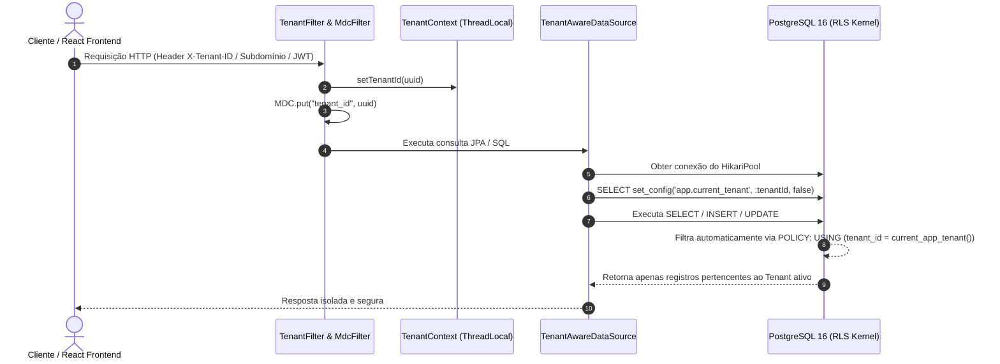

#### B. Estoque Virtual Dinâmico para Kits & Combos
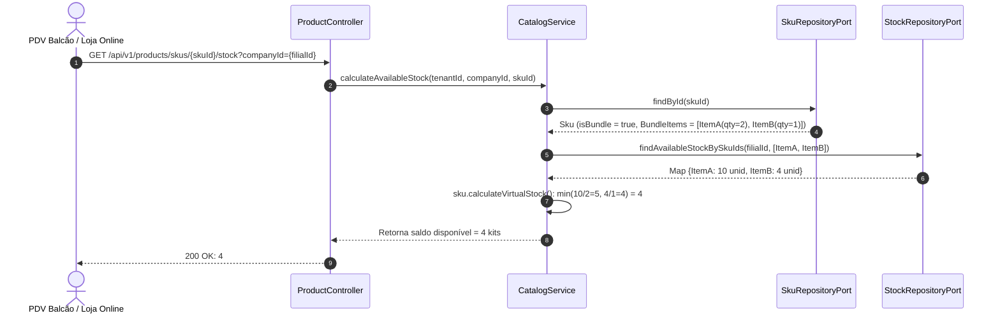

#### C. Rateio e Decomposição Fiscal de Kits para NF-e/NFC-e
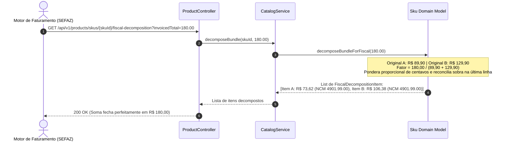

#### D. Importação em Lote via Streaming com Rollback Isolado
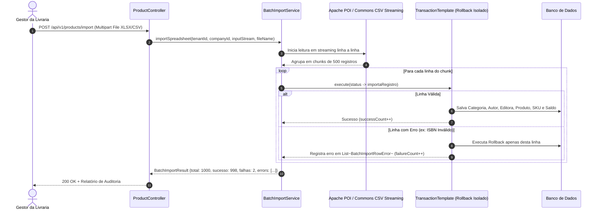

#### E. Remessa de Estoque para Evento / Feira e Emissão de Romaneio
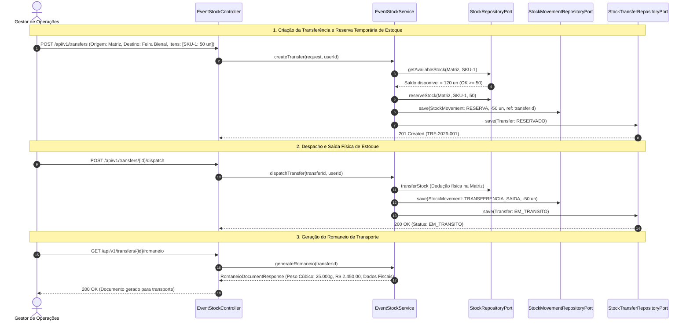

#### F. Conferência Cega de Retorno com Bipagem e Conciliação no Ledger
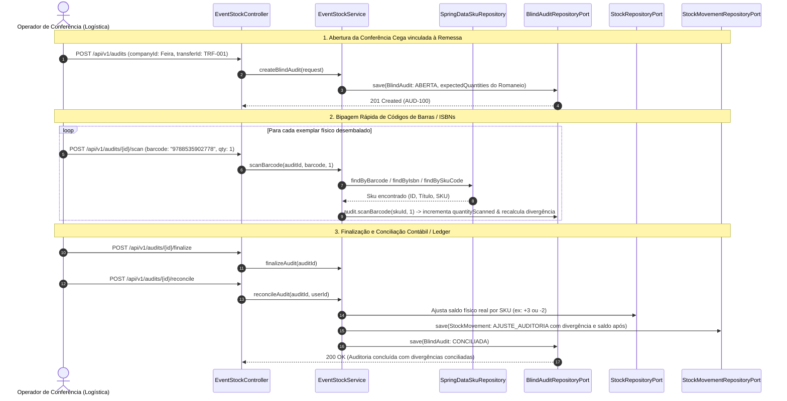

#### G. Turno de Caixa, Suprimento, Sangria e Fechamento Cego
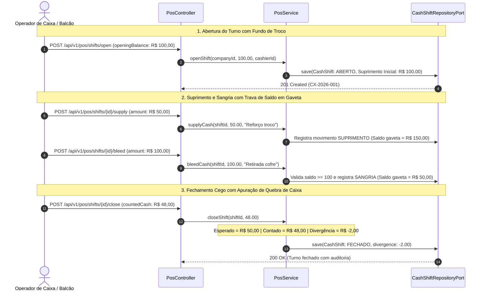

#### H. Venda Balcão / Feira, Múltiplos Pagamentos, Baixa de Estoque e NFC-e
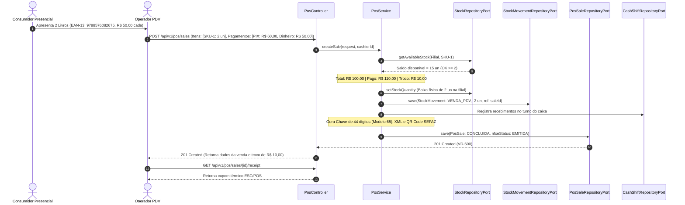

#### I. PDV Offline & Ingestão Resiliente com Chave de Idempotência
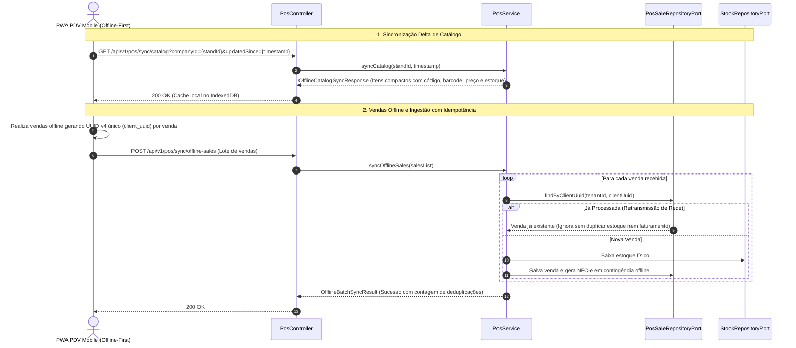

#### J. Checkout Transparente e Webhooks Assíncronos Pagar.me V5 (Idempotência e Mensageria)
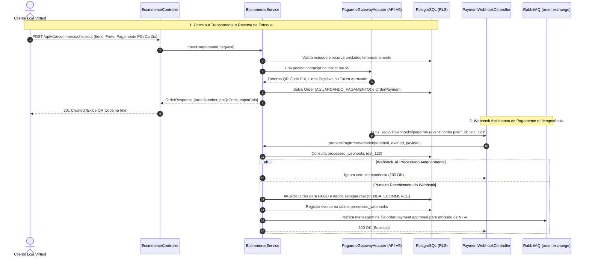

#### K. Venda a Prazo / Orçamento Institucional e Trava de Inadimplência Obrigatória
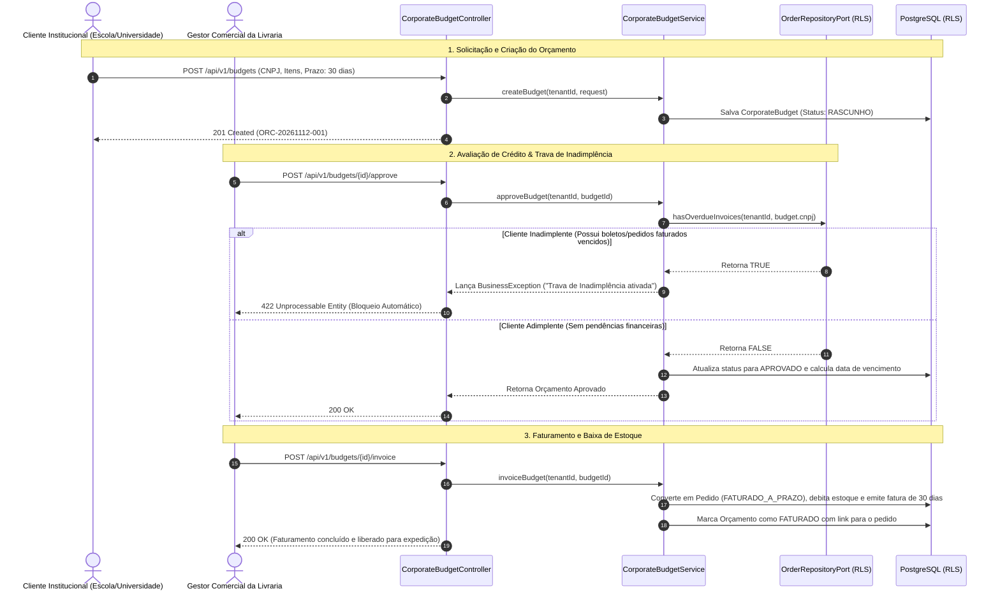

#### L. Homologação Fiscal SEFAZ: Emissão de NF-e 55, Chave de Acesso Módulo 11 e Contingência Offline
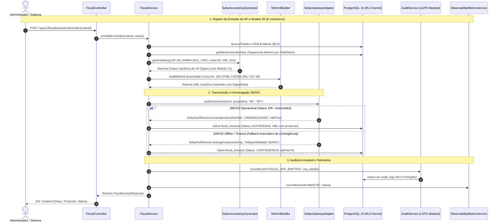

#### M. Observabilidade Distribuída, Trilha de Auditoria Imutável (LGPD/PCI-DSS) e Métricas Prometheus
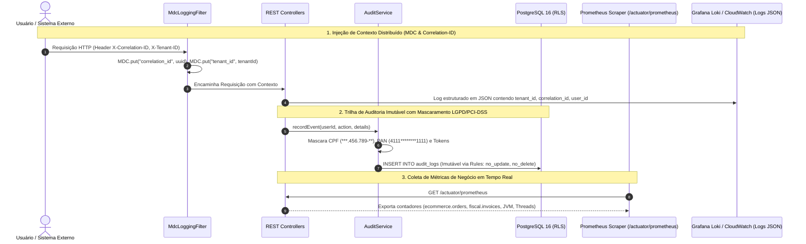

---

### Isolamento Multi-Tenant com PostgreSQL RLS (Row-Level Security)
Diferente de abordagens frágeis onde o isolamento depende exclusivamente de cláusulas `WHERE tenant_id = ?` no código da aplicação, a plataforma utiliza **Row-Level Security (RLS) nativo no PostgreSQL**:
1. O filtro HTTP intercepta a requisição e extrai o `tenant_id` (via cabeçalho `X-Tenant-ID`, subdomínio ou token JWT).
2. O `TenantAwareDataSource` injeta o contexto na conexão do pool HikariCP: `SELECT set_config('app.current_tenant', :tenantId, false)`.
3. O PostgreSQL bloqueia nativamente em nível de engine qualquer tentativa de leitura ou escrita fora do tenant ativo através da política com `FORCE ROW LEVEL SECURITY`.

---

## 2. Stack de Infraestrutura & Observabilidade (Fase 1: VPS)

Projetado sob o princípio do **Twelve-Factor App** e **Zero Cloud-Lock-In**, permitindo execução idêntica em máquina local, em VPS Linux com Docker Compose, ou em serviços gerenciados AWS (ECS/RDS/ElastiCache/S3) apenas alterando variáveis de ambiente.

| Serviço | Tecnologia | Papel no Ecossistema |
| :--- | :--- | :--- |
| **Roteamento & SSL** | Traefik v3 | Descoberta automática de containers e emissão de SSL Let's Encrypt |
| **Banco de Dados** | PostgreSQL 16 Alpine | Banco relacional com RLS e extensões `uuid-ossp` e `pgcrypto` |
| **Cache & Sessões** | Redis 7.2 Alpine | Cache de alta velocidade, sessões e rate limiting |
| **Armazenamento S3** | MinIO Server | S3-compatible local com buckets pré-configurados (`ecommerce-media`, `ecommerce-ebooks`) |
| **Mensageria** | RabbitMQ 3.13 Management | Processamento assíncrono de NF-e, webhooks e notificações |
| **Métricas** | Prometheus + Micrometer | Coleta de métricas da JVM, Virtual Threads e latências de checkout |
| **Logs Estruturados** | Grafana Loki + Promtail | Ingestão e agregação de logs JSON em streaming com labels de MDC |
| **Visualização & Alertas** | Grafana 11.2 | Dashboards visuais em tempo real, painel de logs e consulta LogQL |

### 2.1. Arquitetura de Monitoramento de Logs & Métricas

```
┌────────────────────────────────────────────────────────┐
│             Backend Spring Boot 3.3.5                  │
│                                                        │
│  MdcLoggingFilter (tenant_id, correlation_id, user_id) │
│                          │                             │
│                          ▼                             │
│       LogstashEncoder (Logback Console JSON)           │
└──────────────────────────┬─────────────────────────────┘
                           │ stdout (Docker logging driver)
                           ▼
┌────────────────────────────────────────────────────────┐
│            Promtail Container (Daemon Log Collector)   │
│   Lê /var/run/docker.sock e anota metadados de tags    │
└──────────────────────────┬─────────────────────────────┘
                           │ HTTP POST /loki/api/v1/push
                           ▼
┌────────────────────────────────────────────────────────┐
│                   Grafana Loki                         │
│       Indexação de streams por labels e chunks TSDB    │
└──────────────────────────┬─────────────────────────────┘
                           │
                           ▼
┌────────────────────────────────────────────────────────┐
│                 Grafana Dashboard (Port 3000)          │
│   Dashboards pré-provisionados com LogQL e Prometheus  │
└────────────────────────────────────────────────────────┘
```

#### Consultas LogQL de Referência (Loki)
- **Logs por Tenant isolado:** `{container="ecommerce-backend"} | json | tenant_id="00000000-0000-0000-0000-000000000001"`
- **Rastreabilidade por Correlation ID:** `{container="ecommerce-backend"} | json | correlation_id="<uuid>"`
- **Filtro de Exceções:** `{container="ecommerce-backend"} | json | level="ERROR"`
- **Erros de Transmissão SEFAZ:** `{container="ecommerce-backend"} |= "SEFAZ" |= "ERROR"`

---

## 3. Catálogo de Endpoints REST & Especificação de Serviços

### 3.1. Catálogo Completo de Endpoints REST

| Método | Endpoint | Permissão RBAC | Descrição |
| :--- | :--- | :--- | :--- |
| `GET` | `/api/v1/health` | Pública | Health check com verificação de Virtual Threads |
| `GET` | `/docs` ou `/documentation` | Pública | Portal HTML interativo de documentação e diagramas UML |
| `GET` | `/api/v1/auth/tenant-info` | Pública | Resolução visual do Tenant para a tela de login |
| `POST` | `/api/v1/auth/login` | Pública | Autenticação por credenciais com emissão de Access e Refresh Token |
| `POST` | `/api/v1/auth/refresh` | Pública | Rotação de Refresh Token com invalidação anterior no Redis |
| `POST` | `/api/v1/auth/logout` | Autenticado | Inclusão do token na blacklist do Redis e revogação de sessão |
| `POST` | `/api/v1/tenants` | `SUPER_ADMIN` | Cadastro de novo Tenant |
| `GET` | `/api/v1/tenants/{id}` | `SUPER_ADMIN` | Buscar Tenant por ID |
| `GET` | `/api/v1/tenants/slug/{slug}` | `SUPER_ADMIN` | Buscar Tenant por slug |
| `POST` | `/api/v1/companies` | `TENANT_ADMIN` | Cadastrar filial ou stand de feira/evento |
| `GET` | `/api/v1/companies/{id}` | Autenticado | Buscar filial por ID |
| `GET` | `/api/v1/companies/code/{code}` | Autenticado | Buscar filial pelo código mnemônico (ex: MATRIZ) |
| `GET` | `/api/v1/companies` | Autenticado | Listar todas as filiais do Tenant |
| `POST` | `/api/v1/users` | `USER_MANAGE` | Criar novo usuário com atribuição de cargo e lojas permitidas |
| `GET` | `/api/v1/users/me` | Autenticado | Consultar perfil, filiais e permissões do usuário logado |
| `GET` | `/api/v1/users/{id}` | `USER_MANAGE` | Buscar colaborador por ID |
| `PUT` | `/api/v1/users/{id}` | `USER_MANAGE` | Atualizar dados do colaborador |
| `PUT` | `/api/v1/users/{id}/password` | `USER_MANAGE` | Redefinição de senha com hash BCrypt |
| `PATCH` | `/api/v1/users/{id}/status` | `USER_MANAGE` | Bloquear ou desbloquear colaborador |
| `POST` | `/api/v1/taxonomy/categories` | `CATALOG_WRITE` | Criar categoria de produto |
| `GET` | `/api/v1/taxonomy/categories` | Pública | Listar categorias do Tenant |
| `POST` | `/api/v1/taxonomy/authors` | `CATALOG_WRITE` | Cadastrar autor |
| `GET` | `/api/v1/taxonomy/authors` | Pública | Listar todos os autores |
| `POST` | `/api/v1/taxonomy/publishers` | `CATALOG_WRITE` | Cadastrar editora |
| `GET` | `/api/v1/taxonomy/publishers` | Pública | Listar todas as editoras |
| `POST` | `/api/v1/products` | `CATALOG_WRITE` | Criar Produto Pai com SKUs iniciais opcionais |
| `PUT` | `/api/v1/products/{id}` | `CATALOG_WRITE` | Atualizar metadados gerais do Produto Pai |
| `GET` | `/api/v1/products/{id}` | Pública | Buscar produto completo por ID com variações e autores |
| `GET` | `/api/v1/products/slug/{slug}` | Pública | Buscar produto pelo slug amigável (Loja Pública / SEO) |
| `GET` | `/api/v1/products` | Pública | Pesquisar catálogo com filtros facetados e paginação |
| `DELETE` | `/api/v1/products/{id}` | `CATALOG_WRITE` | Remover produto e todas as suas variações associadas |
| `POST` | `/api/v1/products/{id}/skus` | `CATALOG_WRITE` | Adicionar SKU/Variação ao produto com dados de frete e fiscais |
| `PUT` | `/api/v1/products/skus/{skuId}` | `CATALOG_WRITE` | Atualizar variação (SKU) |
| `GET` | `/api/v1/products/skus/{skuId}` | Pública | Buscar SKU por ID |
| `GET` | `/api/v1/products/skus/barcode/{barcode}` | Pública | Busca rápida de SKU por código de barras (EAN-13) para PDV |
| `GET` | `/api/v1/products/skus/isbn/{isbn}` | Pública | Busca de SKU por ISBN com validação de formato |
| `DELETE` | `/api/v1/products/skus/{skuId}` | `CATALOG_WRITE` | Remover variação |
| `GET` | `/api/v1/products/skus/{skuId}/stock` | Pública | Saldo disponível por filial (calcula dinamicamente para Kits) |
| `GET` | `/api/v1/products/skus/{skuId}/fiscal-decomposition` | Pública | Decomposição e rateio proporcional de combo para NF-e/NFC-e |
| `POST` | `/api/v1/products/{id}/upload-cover-url` | `CATALOG_WRITE` | Gerar URL pré-assinada do S3 para upload direto de capa |
| `POST` | `/api/v1/products/skus/{skuId}/upload-ebook-url` | `CATALOG_WRITE` | Gerar URL pré-assinada do S3 para upload de arquivo digital |
| `GET` | `/api/v1/products/skus/{skuId}/download-ebook-url` | Autenticado | Gerar link temporário de download do e-book para cliente autorizado |
| `POST` | `/api/v1/products/import` | `CATALOG_WRITE` | Upload e importação em streaming de XLSX/CSV com rollback isolado |
| `POST` | `/api/v1/transfers` | `STOCK_WRITE` | Criar transferência/remessa de estoque para evento ou filial com reserva |
| `GET` | `/api/v1/transfers` | `STOCK_READ` | Listar transferências de estoque (com filtro opcional por filial) |
| `GET` | `/api/v1/transfers/{id}` | `STOCK_READ` | Obter detalhes de uma transferência de estoque por ID |
| `POST` | `/api/v1/transfers/{id}/dispatch` | `STOCK_WRITE` | Despachar transferência de estoque (coloca em trânsito) |
| `POST` | `/api/v1/transfers/{id}/receive` | `STOCK_WRITE` | Confirmar recebimento com detecção automática de divergência |
| `GET` | `/api/v1/transfers/{id}/romaneio` | `STOCK_READ` | Gerar Romaneio formal de transporte e carga com pesos cúbicos e fiscais |
| `POST` | `/api/v1/audits` | `STOCK_WRITE` | Criar conferência cega (bipagem pós-feira ou auditoria física) |
| `GET` | `/api/v1/audits` | `STOCK_READ` | Listar conferências cegas de uma empresa/stand (`companyId`) |
| `GET` | `/api/v1/audits/{id}` | `STOCK_READ` | Obter detalhes da conferência cega, itens bipados e divergências |
| `POST` | `/api/v1/audits/{id}/scan` | `STOCK_WRITE` | Bipar código de barras (EAN-13, ISBN ou SKU) incrementando contagem |
| `POST` | `/api/v1/audits/{id}/finalize` | `STOCK_WRITE` | Finalizar contagem da conferência cega e fechar período de bipagem |
| `POST` | `/api/v1/audits/{id}/reconcile` | `STOCK_WRITE` | Conciliar saldos físicos com base nas divergências da conferência no ledger |
| `GET` | `/api/v1/stock/movements` | `STOCK_READ` | Consultar histórico contábil e imutável de movimentações de estoque (ledger) |
| `GET` | `/api/v1/events/{companyId}/dashboard` | `STOCK_READ` | Dashboard em tempo real do evento/feira: despachados, faturamento e alertas |

### 3.2. Exemplos de Requisições via cURL

#### 1. Verificar integridade do backend
```bash
curl -X GET http://localhost:8080/api/v1/health
```

#### 2. Autenticar usuário default (Tenant Matriz)
```bash
curl -X POST http://localhost:8080/api/v1/auth/login \
  -H "Content-Type: application/json" \
  -d '{
    "tenantId": "00000000-0000-0000-0000-000000000001",
    "email": "admin@livrariamatriz.com.br",
    "password": "Admin@123456"
  }'
```

#### 3. Cadastrar um Livro Pai com SKU e ISBN
```bash
curl -X POST http://localhost:8080/api/v1/products \
  -H "Content-Type: application/json" \
  -H "Authorization: Bearer <SEU_JWT_TOKEN>" \
  -H "X-Tenant-ID: 00000000-0000-0000-0000-000000000001" \
  -d '{
    "tenantId": "00000000-0000-0000-0000-000000000001",
    "title": "Clean Code",
    "slug": "clean-code",
    "synopsis": "Um guia para o desenvolvimento de software ágil.",
    "productType": "BOOK",
    "initialSkus": [
      {
        "tenantId": "00000000-0000-0000-0000-000000000001",
        "skuCode": "LIV-CLEAN-CODE",
        "barcode": "9788576082675",
        "isbn": "978-85-7608-267-5",
        "bindingType": "BROCHURA",
        "weightGrams": 650,
        "height": 23.0,
        "width": 16.0,
        "depth": 2.5,
        "price": 89.90,
        "ncm": "4901.99.00",
        "cfop": "5102"
      }
    ]
  }'
```

#### 4. Consultar Rateio Fiscal de um Kit de Livros
```bash
curl -X GET "http://localhost:8080/api/v1/products/skus/<SKU_KIT_ID>/fiscal-decomposition?invoicedTotal=150.00"
```

#### 5. Importar Planilha de Estoque em Lote (Streaming XLSX/CSV)
```bash
curl -X POST "http://localhost:8080/api/v1/products/import" \
  -H "Authorization: Bearer <SEU_JWT_TOKEN>" \
  -H "X-Tenant-ID: 00000000-0000-0000-0000-000000000001" \
  -F "file=@planilha_livros.csv"
```

---

## 4. Deploy em Produção (VPS Linux - Hostinger KVM2: 8GB RAM, 2 vCPUs)

Com o **Frontend desacoplado e hospedado no Netlify**, 100% dos recursos da VPS ficam dedicados à infraestrutura de backend, dados e mensageria. A orquestração [docker-compose.vps.yml](docker-compose.vps.yml) foi calibrada especificamente para uma máquina de **8 GB de RAM e 2 vCPUs**:

### Orçamento de Memória e vCPU (8 GB RAM / 2 vCPUs)

| Container / Serviço | Limite Memória | Reserva (Base) | Limite CPU | Otimizações Específicas Aplicadas |
| :--- | :--- | :--- | :--- | :--- |
| **Backend (Java 21 / Spring Boot 3)** | `1792 MB` | `1024 MB` | `1.8 vCPU` | G1GC (`MaxGCPauseMillis=100`), String Deduplication, Virtual Threads, Heap: `-Xms768m -Xmx1344m`, HikariCP: `max=10, min=4` |
| **PostgreSQL 16 (Alpine)** | `1536 MB` | `512 MB` | `1.5 vCPU` | `shared_buffers=384MB`, `effective_cache_size=1280MB`, `work_mem=8MB`, `random_page_cost=1.1` (NVMe), `max_conn=60` |
| **Redis 7.2 (Alpine)** | `384 MB` | `128 MB` | `0.5 vCPU` | `--maxmemory 256mb`, política `allkeys-lru`, AOF persistente |
| **RabbitMQ 3.13 (Alpine)** | `512 MB` | `256 MB` | `0.75 vCPU` | `RABBITMQ_VM_MEMORY_HIGH_WATERMARK=0.6`, thread pooling Erlang otimizado |
| **MinIO (S3 Local)** | `512 MB` | `256 MB` | `0.75 vCPU` | `GOMAXPROCS=1`, upload/download de mídia e e-books |
| **Traefik v3.1 (Proxy + SSL)** | `192 MB` | `64 MB` | `0.5 vCPU` | Let's Encrypt automático, compressão gzip/zstd, roteamento SSL |
| **Prometheus v2.54** | `384 MB` | `192 MB` | `0.5 vCPU` | Scrape a cada 30s (redução de 66% de overhead de CPU), retenção de 7 dias / 4GB |
| **Grafana Loki 3.2** | `384 MB` | `192 MB` | `0.5 vCPU` | Compactador e retenção ativa de 7 dias (168h), TSDB filesystem |
| **Grafana Promtail 3.2** | `128 MB` | `64 MB` | `0.25 vCPU` | Scrape de Docker socket com intervalo de 15s |
| **Grafana 11.2** | `256 MB` | `128 MB` | `0.5 vCPU` | Dashboard persistente, visualização rápida |
| **Buffer Livre (OS / Linux Cache)** | **~2.1 GB** | — | — | Headroom reservado para Kernel, Docker daemon e Linux Page Cache do NVMe |

### Comandos de Inicialização na VPS

```bash
# 1. Configurar variáveis no servidor
cp .env.example .env
nano .env  # Configurar DOMAIN_NAME, TRAEFIK_ACME_EMAIL e senhas seguras

# 2. Inicializar os serviços com Traefik, SSL Let's Encrypt e limites de recursos
docker compose -f docker-compose.vps.yml up -d
```

### Otimizações do Sistema Operacional Ubuntu (Host KVM2)
Execute uma única vez no servidor Ubuntu para garantir estabilidade e evitar OOM killer:
```bash
# Criar swapfile de 4GB no NVMe como rede de segurança
sudo fallocate -l 4G /swapfile && sudo chmod 600 /swapfile
sudo mkswap /swapfile && sudo swapon /swapfile
echo '/swapfile none swap sw 0 0' | sudo tee -a /etc/fstab

# Ajustar parâmetros de kernel recomendados para banco e containers
sudo sysctl -w vm.swappiness=10
sudo sysctl -w vm.max_map_count=262144
sudo sysctl -w fs.file-max=2097152
```

### Rotina de Backup Automatizado do Banco
O repositório inclui o script [backup-postgres.sh](file:///home/npd/Downloads/projects/e-commerce-livraria/scripts/backup-postgres.sh) com `pg_dump` compactado e rotação automática de 7 dias:
```bash
# Adicione ao crontab do servidor para executar diariamente às 03:00 da manhã
0 3 * * * /opt/ecommerce-backend/scripts/backup-postgres.sh >> /var/log/pg_backup.log 2>&1
```

---

## 5. Transição Transparente para Nuvem AWS (Fase 2)

O backend possui desacoplamento total de provedor de nuvem via variáveis de ambiente:
- **Armazenamento:** Para migrar do MinIO para Amazon S3 nativo, remova a variável `AWS_ENDPOINT_URL` e preencha as credenciais AWS IAM. O código Java utiliza `software.amazon.awssdk:s3` sem qualquer alteração.
- **Banco de Dados:** Aponte `SPRING_DATASOURCE_URL` para o endpoint do Amazon RDS PostgreSQL Multi-AZ.
- **Cache:** Aponte `SPRING_DATA_REDIS_HOST` para o Amazon ElastiCache Redis.

---
