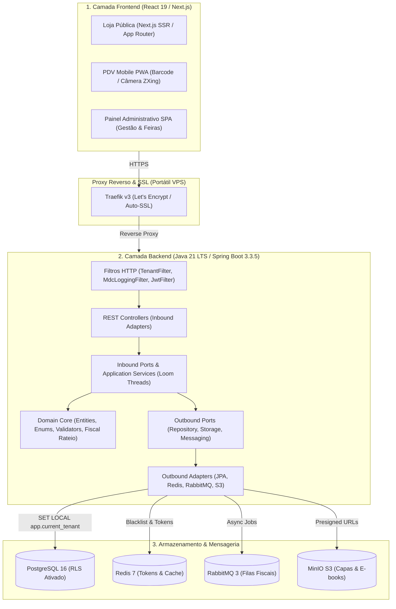
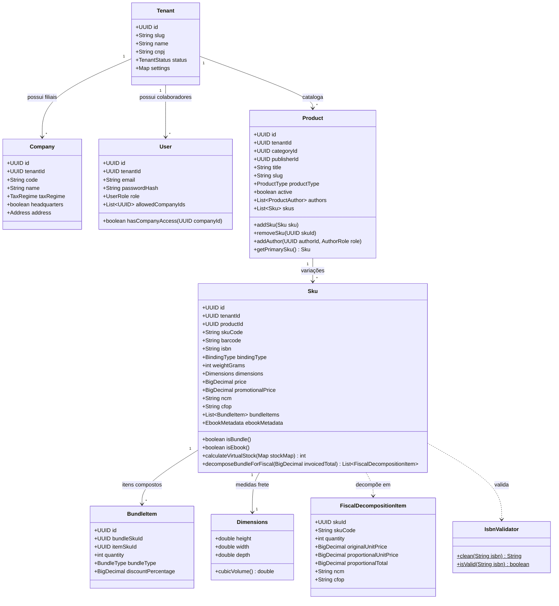
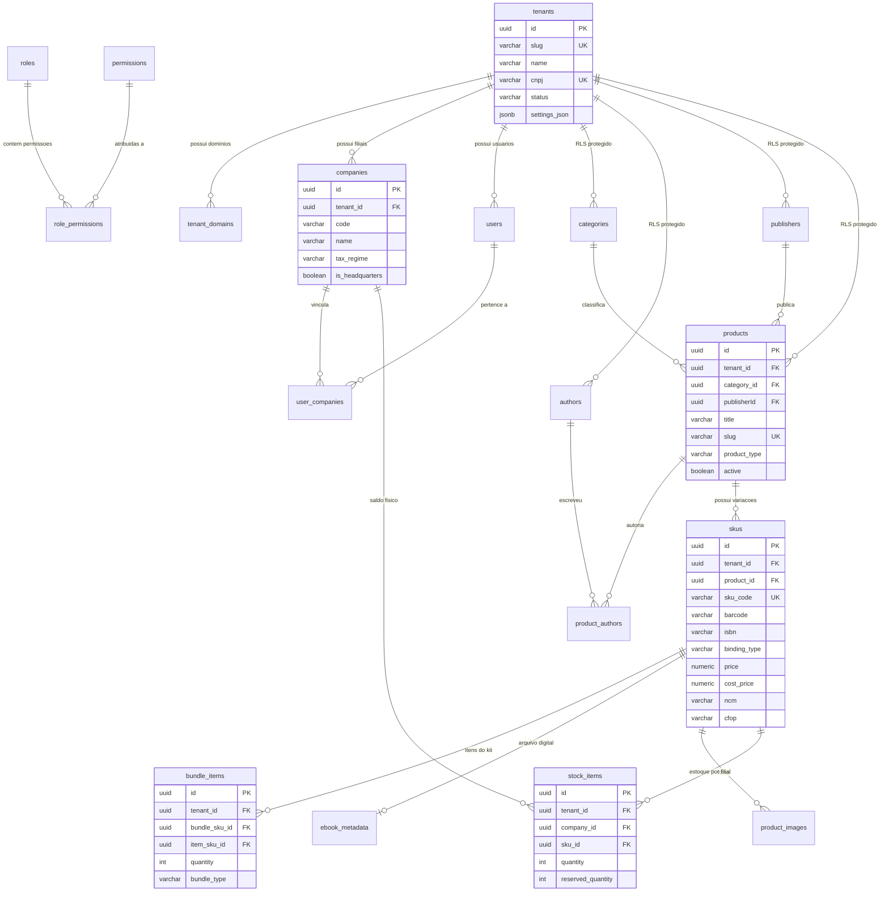
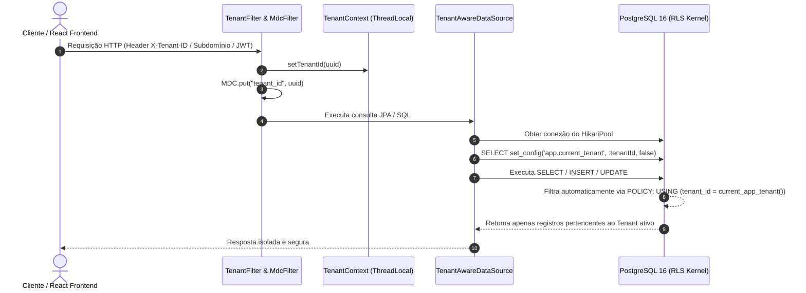
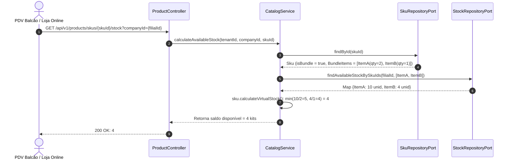
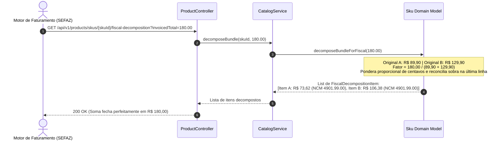
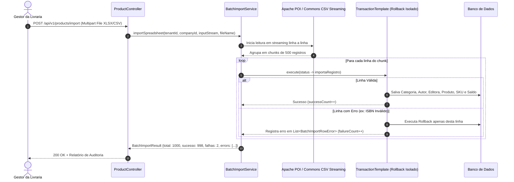

# Plataforma de E-commerce, PDV e Gestão Multi-Tenant (Backend & Infraestrutura)

[](https://github.com/usuario/e-commerce-livraria/actions/workflows/ci.yml)
[](https://openjdk.org/projects/jdk/21/)
[](https://spring.io/projects/spring-boot)
[](https://docs.docker.com/compose/)
[](#arquitetura-do-backend)

Repositório central de **Backend e Infraestrutura Portátil** da nova plataforma de e-commerce, frente de caixa (PDV) e gestão para livrarias e varejo em geral, substituindo a infraestrutura legada baseada em WordPress/WooCommerce.

> O **Frontend** (Next.js SSR para loja pública e React PWA para PDV/Painel) é mantido em repositório dedicado desacoplado.

---

## 1. Visão Geral da Arquitetura & Diagramas UML

O sistema adota o padrão **Clean Architecture / Arquitetura Hexagonal (Ports & Adapters)** com **Java 21 LTS** e **Project Loom (Virtual Threads)** ativadas nativamente para altíssima concorrência I/O:

```
src/main/java/com/livraria/ecommerce/
├── domain/                    # Núcleo de regras de negócio puras (sem dependência de frameworks)
│   ├── model/                 # Entidades e Value Objects (Tenant, User, Product, Sku, etc.)
│   ├── port/in/               # Use Cases / Portas de Entrada (CatalogUseCase, BatchImportUseCase, etc.)
│   ├── port/out/              # Portas de Saída (Repositórios, Storage, Mensageria)
│   └── exception/             # Exceções de Domínio e Negócio
├── application/               # Serviços de Aplicação e Orquestração
│   ├── service/               # Implementação dos Use Cases (CatalogService, BatchImportService, etc.)
│   └── dto/                   # DTOs de comando e transferência
└── infrastructure/            # Adaptadores de Tecnologia e Frameworks
    ├── adapters/in/web/       # Controllers REST, Filtros (Tenant, MDC Logging), Exception Handlers e /docs
    ├── adapters/out/          # Implementações das Portas de Saída:
    │   ├── persistence/       # PostgreSQL com Row-Level Security (RLS) e HikariCP Tenant Aware
    │   └── storage/           # AWS SDK v2 (S3 nativo e MinIO local compatível com presigned URLs)
    ├── config/                # Configurações Spring (Segurança, OpenAPI, RabbitMQ, Redis, DataSource)
    └── security/              # Autenticação JWT, UserPrincipal e Filtros de Segurança
```

### 1.1. Diagrama de Arquitetura em 3 Camadas



### 1.2. Diagrama de Classes de Domínio (UML Class Diagram)

O diagrama abaixo ilustra o núcleo de domínio, com separação de Produto Pai, Variações (SKUs), Composição de Kits Virtuais/Físicos e Validação de ISBN:



### 1.3. Diagrama Entidade-Relacionamento (ER) com Row-Level Security

Todas as tabelas de escopo do lojista possuem `tenant_id` e políticas ativas com `FORCE ROW LEVEL SECURITY`:



### 1.4. Diagramas de Sequência dos Principais Fluxos

#### A. Multi-Tenancy RLS e Injeção de Sessão no HikariCP


#### B. Estoque Virtual Dinâmico para Kits & Combos


#### C. Rateio e Decomposição Fiscal de Kits para NF-e/NFC-e


#### D. Importação em Lote via Streaming com Rollback Isolado


---

### Isolamento Multi-Tenant com PostgreSQL RLS (Row-Level Security)
Diferente de abordagens frágeis onde o isolamento depende exclusivamente de cláusulas `WHERE tenant_id = ?` no código da aplicação, a plataforma utiliza **Row-Level Security (RLS) nativo no PostgreSQL**:
1. O filtro HTTP intercepta a requisição e extrai o `tenant_id` (via cabeçalho `X-Tenant-ID`, subdomínio ou token JWT).
2. O `TenantAwareDataSource` injeta o contexto na conexão do pool HikariCP: `SELECT set_config('app.current_tenant', :tenantId, false)`.
3. O PostgreSQL bloqueia nativamente em nível de engine qualquer tentativa de leitura ou escrita fora do tenant ativo através da política com `FORCE ROW LEVEL SECURITY`.

---

## 2. Stack de Infraestrutura & Observabilidade (Fase 1: VPS)

Projetado sob o princípio do **Twelve-Factor App** e **Zero Cloud-Lock-In**, permitindo execução idêntica em máquina local, em VPS Linux com Docker Compose, ou em serviços gerenciados AWS (ECS/RDS/ElastiCache/S3) apenas alterando variáveis de ambiente.

| Serviço | Tecnologia | Papel no Ecossistema |
| :--- | :--- | :--- |
| **Roteamento & SSL** | Traefik v3 | Descoberta automática de containers e emissão de SSL Let's Encrypt |
| **Banco de Dados** | PostgreSQL 16 Alpine | Banco relacional com RLS e extensões `uuid-ossp` e `pgcrypto` |
| **Cache & Sessões** | Redis 7.2 Alpine | Cache de alta velocidade, sessões e rate limiting |
| **Armazenamento S3** | MinIO Server | S3-compatible local com buckets pré-configurados (`ecommerce-media`, `ecommerce-ebooks`) |
| **Mensageria** | RabbitMQ 3.13 Management | Processamento assíncrono de NF-e, webhooks e notificações |
| **Métricas** | Prometheus + Micrometer | Coleta de métricas da JVM, Virtual Threads e latências de checkout |
| **Logs Estruturados** | Grafana Loki + Promtail | Centralização de logs estruturados em JSON com campos de MDC |

---

## 3. Início Rápido (Desenvolvimento Local)

### Pré-requisitos
- [Docker](https://docs.docker.com/engine/install/) e [Docker Compose](https://docs.docker.com/compose/)
- [Java 21 OpenJDK](https://adoptium.net/) (opcional se for executar via Docker)
- [Maven 3.8+](https://maven.apache.org/) (opcional se for executar via Docker)

### Passo a Passo

1. **Clone o repositório:**
   ```bash
   git clone https://github.com/seu-usuario/e-commerce-livraria.git
   cd e-commerce-livraria
   ```

2. **Crie o arquivo de variáveis de ambiente:**
   ```bash
   cp .env.example .env
   ```

3. **Inicie todos os serviços com o Docker Compose:**
   ```bash
   docker compose up -d
   ```

4. **Verifique o status dos serviços:**
   ```bash
   docker compose ps
   ```

5. **Acompanhe os logs da aplicação:**
   ```bash
   docker compose logs -f backend
   ```

---

## 4. Endpoints da API & Documentação Viva

Após iniciar a aplicação, acesse as interfaces de documentação e observabilidade:

| Recurso | URL Local | Descrição |
| :--- | :--- | :--- |
| **Documentação Técnica & UML Viva** | `http://localhost:8080/docs` | **Portal web interativo completo com diagramas UML dinâmicos e catálogo de rotas** |
| **Especificação Completa (Markdown)** | [ARCHITECTURE.md](file:///home/npd/Downloads/projects/e-commerce-livraria/ARCHITECTURE.md) | Documento arquitetural aprofundado com regras e fórmulas |
| **Swagger UI (OpenAPI 3)** | `http://localhost:8080/swagger-ui.html` | Documentação interativa e console para teste de rotas REST |
| **OpenAPI Docs (JSON)** | `http://localhost:8080/v3/api-docs` | Especificação OpenAPI 3 em JSON bruto |
| **Health Check da API** | `http://localhost:8080/api/v1/health` | Estado do backend, ambiente e Virtual Threads ativas |
| **Métricas Prometheus** | `http://localhost:8080/actuator/prometheus` | Métricas de sistema e negócio para Grafana |
| **Painel MinIO Console** | `http://localhost:9001` | Credenciais: `minio_admin_user` / `minio_admin_secret_password` |
| **Painel RabbitMQ** | `http://localhost:15672` | Credenciais: `rabbit_user` / `rabbit_secret_password` |

### 4.1. Catálogo Completo de Endpoints REST

| Método | Endpoint | Permissão RBAC | Descrição |
| :--- | :--- | :--- | :--- |
| `GET` | `/api/v1/health` | Pública | Health check com verificação de Virtual Threads |
| `GET` | `/docs` ou `/documentation` | Pública | Portal HTML interativo de documentação e diagramas UML |
| `GET` | `/api/v1/auth/tenant-info` | Pública | Resolução visual do Tenant para a tela de login |
| `POST` | `/api/v1/auth/login` | Pública | Autenticação por credenciais com emissão de Access e Refresh Token |
| `POST` | `/api/v1/auth/refresh` | Pública | Rotação de Refresh Token com invalidação anterior no Redis |
| `POST` | `/api/v1/auth/logout` | Autenticado | Inclusão do token na blacklist do Redis e revogação de sessão |
| `POST` | `/api/v1/tenants` | `SUPER_ADMIN` | Cadastro de novo Tenant |
| `GET` | `/api/v1/tenants/{id}` | `SUPER_ADMIN` | Buscar Tenant por ID |
| `GET` | `/api/v1/tenants/slug/{slug}` | `SUPER_ADMIN` | Buscar Tenant por slug |
| `POST` | `/api/v1/companies` | `TENANT_ADMIN` | Cadastrar filial ou stand de feira/evento |
| `GET` | `/api/v1/companies/{id}` | Autenticado | Buscar filial por ID |
| `GET` | `/api/v1/companies/code/{code}` | Autenticado | Buscar filial pelo código mnemônico (ex: MATRIZ) |
| `GET` | `/api/v1/companies` | Autenticado | Listar todas as filiais do Tenant |
| `POST` | `/api/v1/users` | `USER_MANAGE` | Criar novo usuário com atribuição de cargo e lojas permitidas |
| `GET` | `/api/v1/users/me` | Autenticado | Consultar perfil, filiais e permissões do usuário logado |
| `GET` | `/api/v1/users/{id}` | `USER_MANAGE` | Buscar colaborador por ID |
| `PUT` | `/api/v1/users/{id}` | `USER_MANAGE` | Atualizar dados do colaborador |
| `PUT` | `/api/v1/users/{id}/password` | `USER_MANAGE` | Redefinição de senha com hash BCrypt |
| `PATCH` | `/api/v1/users/{id}/status` | `USER_MANAGE` | Bloquear ou desbloquear colaborador |
| `POST` | `/api/v1/taxonomy/categories` | `CATALOG_WRITE` | Criar categoria de produto |
| `GET` | `/api/v1/taxonomy/categories` | Pública | Listar categorias do Tenant |
| `POST` | `/api/v1/taxonomy/authors` | `CATALOG_WRITE` | Cadastrar autor |
| `GET` | `/api/v1/taxonomy/authors` | Pública | Listar todos os autores |
| `POST` | `/api/v1/taxonomy/publishers` | `CATALOG_WRITE` | Cadastrar editora |
| `GET` | `/api/v1/taxonomy/publishers` | Pública | Listar todas as editoras |
| `POST` | `/api/v1/products` | `CATALOG_WRITE` | Criar Produto Pai com SKUs iniciais opcionais |
| `PUT` | `/api/v1/products/{id}` | `CATALOG_WRITE` | Atualizar metadados gerais do Produto Pai |
| `GET` | `/api/v1/products/{id}` | Pública | Buscar produto completo por ID com variações e autores |
| `GET` | `/api/v1/products/slug/{slug}` | Pública | Buscar produto pelo slug amigável (Loja Pública / SEO) |
| `GET` | `/api/v1/products` | Pública | Pesquisar catálogo com filtros facetados e paginação |
| `DELETE` | `/api/v1/products/{id}` | `CATALOG_WRITE` | Remover produto e todas as suas variações associadas |
| `POST` | `/api/v1/products/{id}/skus` | `CATALOG_WRITE` | Adicionar SKU/Variação ao produto com dados de frete e fiscais |
| `PUT` | `/api/v1/products/skus/{skuId}` | `CATALOG_WRITE` | Atualizar variação (SKU) |
| `GET` | `/api/v1/products/skus/{skuId}` | Pública | Buscar SKU por ID |
| `GET` | `/api/v1/products/skus/barcode/{barcode}` | Pública | Busca rápida de SKU por código de barras (EAN-13) para PDV |
| `GET` | `/api/v1/products/skus/isbn/{isbn}` | Pública | Busca de SKU por ISBN com validação de formato |
| `DELETE` | `/api/v1/products/skus/{skuId}` | `CATALOG_WRITE` | Remover variação |
| `GET` | `/api/v1/products/skus/{skuId}/stock` | Pública | Saldo disponível por filial (calcula dinamicamente para Kits) |
| `GET` | `/api/v1/products/skus/{skuId}/fiscal-decomposition` | Pública | Decomposição e rateio proporcional de combo para NF-e/NFC-e |
| `POST` | `/api/v1/products/{id}/upload-cover-url` | `CATALOG_WRITE` | Gerar URL pré-assinada do S3 para upload direto de capa |
| `POST` | `/api/v1/products/skus/{skuId}/upload-ebook-url` | `CATALOG_WRITE` | Gerar URL pré-assinada do S3 para upload de arquivo digital |
| `GET` | `/api/v1/products/skus/{skuId}/download-ebook-url` | Autenticado | Gerar link temporário de download do e-book para cliente autorizado |
| `POST` | `/api/v1/products/import` | `CATALOG_WRITE` | Upload e importação em streaming de XLSX/CSV com rollback isolado |

### 4.2. Exemplos de Requisições via cURL

#### 1. Verificar integridade do backend
```bash
curl -X GET http://localhost:8080/api/v1/health
```

#### 2. Autenticar usuário default (Tenant Matriz)
```bash
curl -X POST http://localhost:8080/api/v1/auth/login \
  -H "Content-Type: application/json" \
  -d '{
    "tenantId": "00000000-0000-0000-0000-000000000001",
    "email": "admin@livrariamatriz.com.br",
    "password": "Admin@123456"
  }'
```

#### 3. Cadastrar um Livro Pai com SKU e ISBN
```bash
curl -X POST http://localhost:8080/api/v1/products \
  -H "Content-Type: application/json" \
  -H "Authorization: Bearer <SEU_JWT_TOKEN>" \
  -H "X-Tenant-ID: 00000000-0000-0000-0000-000000000001" \
  -d '{
    "tenantId": "00000000-0000-0000-0000-000000000001",
    "title": "Clean Code",
    "slug": "clean-code",
    "synopsis": "Um guia para o desenvolvimento de software ágil.",
    "productType": "BOOK",
    "initialSkus": [
      {
        "tenantId": "00000000-0000-0000-0000-000000000001",
        "skuCode": "LIV-CLEAN-CODE",
        "barcode": "9788576082675",
        "isbn": "978-85-7608-267-5",
        "bindingType": "BROCHURA",
        "weightGrams": 650,
        "height": 23.0,
        "width": 16.0,
        "depth": 2.5,
        "price": 89.90,
        "ncm": "4901.99.00",
        "cfop": "5102"
      }
    ]
  }'
```

#### 4. Consultar Rateio Fiscal de um Kit de Livros
```bash
curl -X GET "http://localhost:8080/api/v1/products/skus/<SKU_KIT_ID>/fiscal-decomposition?invoicedTotal=150.00"
```

#### 5. Importar Planilha de Estoque em Lote (Streaming XLSX/CSV)
```bash
curl -X POST "http://localhost:8080/api/v1/products/import" \
  -H "Authorization: Bearer <SEU_JWT_TOKEN>" \
  -H "X-Tenant-ID: 00000000-0000-0000-0000-000000000001" \
  -F "file=@planilha_livros.csv"
```

---

## 5. Deploy em Produção (VPS Linux)

Para implantação em servidor VPS (Ubuntu/Debian), utilize a orquestração `docker-compose.vps.yml`:

```bash
# 1. Configurar variáveis no servidor
cp .env.example .env
nano .env  # Configurar DOMAIN_NAME, TRAEFIK_ACME_EMAIL e senhas seguras

# 2. Inicializar os serviços com Traefik, SSL Let's Encrypt e limites de recursos
docker compose -f docker-compose.vps.yml up -d
```

### Rotina de Backup Automatizado do Banco
O repositório inclui o script [backup-postgres.sh](file:///home/npd/Downloads/projects/e-commerce-livraria/scripts/backup-postgres.sh) com `pg_dump` compactado e rotação automática de 7 dias:
```bash
# Adicione ao crontab do servidor para executar diariamente às 03:00 da manhã
0 3 * * * /opt/ecommerce-backend/scripts/backup-postgres.sh >> /var/log/pg_backup.log 2>&1
```

---

## 6. Transição Transparente para Nuvem AWS (Fase 2)

O backend possui desacoplamento total de provedor de nuvem via variáveis de ambiente:
- **Armazenamento:** Para migrar do MinIO para Amazon S3 nativo, remova a variável `AWS_ENDPOINT_URL` e preencha as credenciais AWS IAM. O código Java utiliza `software.amazon.awssdk:s3` sem qualquer alteração.
- **Banco de Dados:** Aponte `SPRING_DATASOURCE_URL` para o endpoint do Amazon RDS PostgreSQL Multi-AZ.
- **Cache:** Aponte `SPRING_DATA_REDIS_HOST` para o Amazon ElastiCache Redis.

---

## 7. Roadmap Detalhado de Sprints & Atividades

Plano de ação e cronograma faseado de atividades para o desenvolvimento completo do ecossistema, baseado na especificação técnica oficial:

### Sprint 0: Fundação de Infraestrutura Portátil (VPS/Docker) e Setup de Projeto `[CONCLUÍDO]`
- [x] **Repositórios Monorepo ou Multi-Repo**: Definição da estratégia multi-repo com este repositório dedicado exclusivamente ao Backend Java 21 + Infraestrutura e configurações de deploy.
- [x] **Orquestração Portátil Docker Compose**: Criação de `docker-compose.yml` (dev) e `docker-compose.vps.yml` (produção VPS) completo com Traefik v3, PostgreSQL 16 (RLS ativado), Redis 7, MinIO (S3-compatible) com provisionamento automático de buckets, RabbitMQ 3 e observability stack.
- [x] **Padronização Twelve-Factor App**: Parametrização integral por variáveis de ambiente (`.env.example`, `application.yml`, `application-prod.yml`) garantindo zero cloud-lock-in para chaveamento imediato de MinIO/PostgreSQL para AWS S3/RDS no futuro.
- [x] **Baseline do Projeto Java 21 com Flyway**: Configuração do Spring Boot 3.3.5, Clean Architecture / Arquitetura Hexagonal, isolamento via `TenantAwareDataSource` injetando `SET LOCAL app.current_tenant` no HikariCP, migrações `V1__init_schema_multitenant_rls.sql` e seed `V2__seed_initial_tenant.sql`.
- [x] **Suporte a Virtual Threads (Project Loom)**: Habilitação de concorrência massiva de I/O bloqueante sem contenção de pool de threads do SO (`spring.threads.virtual.enabled=true`).
- [x] **Pipeline de CI/CD (GitHub Actions)**: Configuração de build, testes e compilação Java 21 (`ci.yml`) e deploy automatizado via SSH/Docker Compose na VPS (`deploy.yml`).

---

### Sprint 1: Multi-Tenancy, Autenticação e Gestão de Usuários `[CONCLUÍDO]`
- [x] **Modelo de Dados de Tenants, Empresas e RLS**:
  - Modelagem da tabela `companies` representando matriz, filiais físicas e stands de feiras/eventos vinculados ao Tenant com isolamento RLS.
  - Vínculo N:N de usuários às empresas permitidas (`user_companies`) com proteção estrita por Row-Level Security.
- [x] **Filtro/Interceptor HTTP para Resolução de Tenant**:
  - Extração de `x-tenant-id` a partir do cabeçalho HTTP, subdomínio (`Host`) ou claims do token JWT.
  - Endpoint de resolução pública de dados visuais do tenant (`/api/v1/auth/tenant-info` ou `/api/v1/tenants/resolve`) para customização da tela de login no frontend.
- [x] **Autenticação JWT com Spring Security e RBAC Granular**:
  - Tabelas de permissões (`permissions`), perfis (`roles`) e associação (`role_permissions`).
  - Perfis estruturados: `SUPER_ADMIN`, `TENANT_ADMIN`, `STORE_MANAGER`, `ATTENDANT` (Caixa/Balcão) e `CUSTOMER`.
  - Autenticação stateless com JWT contendo `tenant_id`, `user_id`, `role` e authorities granulares (`CATALOG_WRITE`, `PDV_SELL`, `STOCK_TRANSFER`, etc.).
  - Mecanismo de Refresh Token com rotação e controle de blacklist no Redis.
- [x] **Endpoints de Gestão de Usuários (CRUD)**:
  - Criação, listagem paginada, edição de perfil, redefinição de senha e bloqueio/ativação de colaboradores do tenant.
- [x] **Integração com Frontend (Tela de Login Unificada)**:
  - Disponibilização de contratos REST para seleção e validação visual de loja (cores, logo e nome) antes do envio das credenciais.

---

### Sprint 2: Catálogo de Produtos e Gestão de Estoque em Massa `[CONCLUÍDO]`
- [x] **Modelagem Avançada de Produtos com Variações (Pai & Filhos / SKUs)**:
  - Entidade de Produto Pai concentrando metadados gerais (título, sinopse, autores, editora, categorias).
  - Produtos Filhos (SKUs) com atributos variantes (tipo de encadernação [brochura, capa dura, espiral], volume, ano de edição, ou cor/tamanho para varejo geral).
  - Código de barras próprio por variação (EAN-13 / ISBN), precificação independente e dimensões cúbicas para frete.
- [x] **Modelagem de Dados Específicos para Livros**:
  - ISBN individual por variação (com validador internacional para ISBN-10 e ISBN-13), Ficha Catalográfica padronizada, metadados de Autores/Tradutores/Ilustradores e suporte a E-book com download seguro via URLs pré-assinadas (S3/MinIO).
- [x] **Kits e Combos de Produtos (Bundles / Produtos Compostos)**:
  - *Kit com Estoque Virtual Dinâmico*: disponibilidade calculada dinamicamente pelo menor saldo entre os itens filhos, debitando automaticamente os componentes unitários no faturamento.
  - *Kit Físico Pré-montado*: saldo próprio e reservado.
  - *Motor de Tratamento Fiscal de Kits*: decomposição e rateio proporcional do valor faturado com aplicação de NCM, CFOP e alíquotas fiscais específicas de cada item constituinte na NF-e/NFC-e com reconciliação de centavos.
- [x] **Endpoints REST de CRUD do Catálogo**:
  - Gerenciamento completo de produtos (`/api/v1/products`), variações (`/api/v1/products/{id}/skus`), taxonomia (`/api/v1/taxonomy`), busca por código de barras e ISBN, e geração de URLs pré-assinadas para capas e e-books no S3/MinIO.
- [x] **Módulo de Importação em Lote de Planilhas (Streaming)**:
  - Processamento de arquivos Excel (XLSX) e CSV utilizando Apache POI e Apache Commons CSV em streaming.
  - Processamento em chunks de 500 registros com controle transacional e rollback isolado por linha inválida.
- [x] **Suporte ao Painel Administrativo**:
  - Endpoints para listagem rápida com filtros facetados, seletores dinâmicos de variações e construtor visual de kits.

---

### Sprint 3: Múltiplos Estoques e Gestão de Eventos / Feiras `[PRÓXIMA ETAPA]`
- [ ] **Modelagem de Múltiplos Estoques Físicos**:
  - Entidades de Estoque segregadas por localidade: Matriz, Balcão de Loja Física, Depósito Central e Eventos/Feiras Acadêmicas.
  - Movimentações de Transferência de estoque entre unidades com controle de status (`SOLICITADO`, `EM_TRANSITO`, `RECEBIDO`, `DIVERGENCIA`).
- [ ] **Rotinas de Romaneio de Saída para Eventos**:
  - Geração de romaneio de remessa para feiras e eventos externos com reserva temporária de estoque e emissão de documentação de transporte.
- [ ] **Conferência Cega de Retorno (Bipagem)**:
  - Módulo de conferência cega na volta do evento via leitura de código de barras (bipagem) para apuração imediata de sobras, perdas e conciliação de vendas.
- [ ] **Dashboard Operacional de Feiras em Tempo Real**:
  - Endpoints para acompanhamento em tempo real das vendas presenciais, faturamento por stand e saldo remanescente por evento.

---

### Sprint 4: PDV Mobile e Venda Balcão / Feira
- [ ] **Backend para Suporte a PDV Desacoplado & Modo Offline**:
  - Endpoints ultra-rápidos e leves para sincronização de catálogo, clientes e fila de vendas offline com resolução de conflitos.
- [ ] **Integração com Leitura Óptica de Código de Barras (Câmera & USB)**:
  - Suporte à leitura de EAN-13 e ISBN via BarcodeDetector API / ZXing no PDV mobile e leitores laser USB tradicionais.
- [ ] **Fluxo de Venda Balcão / Evento (Strategy Pattern)**:
  - Bipagem dos itens → aplicação de desconto rápido → pagamento presencial (PIX Dinâmico, Cartão maquininha TEF/POS ou Dinheiro) → baixa imediata e exclusiva no estoque da unidade/feira ativa → conclusão sem frete.
- [ ] **Emissão Instantânea de NFC-e (Modelo 65)**:
  - Emissão síncrona/assíncrona de cupom fiscal eletrônico com impressão térmica (ESC/POS) ou envio digital via WhatsApp/E-mail.
- [ ] **Controle Financeiro de Caixa**:
  - Controle de abertura de caixa, suprimento, sangria (retirada) e fechamento cego de turno com conferência e relatório de quebra de caixa.

---

### Sprint 5: E-Commerce Público, Pagar.me e Vendas a Prazo
- [ ] **Backend para Loja Pública Mobile-First**:
  - Endpoints otimizados para catalogação rápida, busca textual com autocomplete, Drawer de filtros facetados (preço, categoria, autor, editora) e paginação leve.
- [ ] **Carrinho & Checkout Otimizado para 1-Clique**:
  - Cálculo de frete multi-transportadora (Correios e Melhor Envio com caching no Redis).
  - Checkout transparente integrado à API v5 do Pagar.me:
    - **PIX**: geração de QR Code dinâmico e chave "Copia e Cola" em milissegundos.
    - **Cartão de Crédito**: tokenização direta de cartão e antifraude integrado.
    - **Boleto Bancário**: geração com registro imediato.
  - Webhooks assíncronos do Pagar.me com tratamento de idempotência e retentativas automáticas no RabbitMQ.
- [ ] **Fluxo de Venda a Prazo (Faturamento / Orçamento Institucional)**:
  - Criação de Orçamento corporativo pelo gestor ou cliente institucional.
  - Envio do espelho do orçamento para aprovação formal.
  - **Trava de Inadimplência**: bloqueio rigoroso e automático de aprovação de novos orçamentos caso o cliente possua qualquer pedido faturado pendente e vencido, até quitação integral.
  - Orçamento aprovado → geração do boleto faturado (ex.: prazo 30 dias) e liberação do despacho com rastreamento.
- [ ] **Expedição e Logística**:
  - Emissão automática de NF-e (modelo 55) pós-aprovação do pagamento e geração automática de etiquetas de postagem e rastreio.

---

### Sprint 6: Observabilidade, Auditoria e Homologação Fiscal
- [ ] **Telemetria Distribuída e Métricas (OpenTelemetry & Tempo)**:
  - Rastreamento distribuído ponta a ponta correlacionando requisições HTTP, queries SQL no PostgreSQL com RLS e chamadas a gateways externos.
  - Painéis no Grafana monitorando taxa de conversão de checkout, latência da API dos Correios, tempo de resposta da SEFAZ e consumo de CPU/Virtual Threads.
- [ ] **Homologação Fiscal SEFAZ**:
  - Testes e homologação ponta a ponta de emissão, contingência e cancelamento de NF-e (modelo 55) e NFC-e (modelo 65) em ambiente de homologação da SEFAZ.
- [ ] **Testes de Carga & Estresse**:
  - Testes de carga utilizando k6 e Gatling simulando concorrência de 100.000 requisições simultâneas e picos de acessos com Virtual Threads.
- [ ] **Validação do Roteiro de Migração VPS → AWS**:
  - Teste prático de migração com restore de dump no Amazon RDS PostgreSQL e chaveamento de storage MinIO para Amazon S3 nativo via variáveis de ambiente.
