# Plataforma de E-commerce, PDV e Gestão Multi-Tenant (Backend & Infraestrutura)

[](https://github.com/usuario/e-commerce-livraria/actions/workflows/ci.yml)
[](https://openjdk.org/projects/jdk/21/)
[](https://spring.io/projects/spring-boot)
[](https://docs.docker.com/compose/)
[](#arquitetura-do-backend)

Repositório central de **Backend e Infraestrutura Portátil** da nova plataforma de e-commerce, frente de caixa (PDV) e gestão para livrarias e varejo em geral, substituindo a infraestrutura legada baseada em WordPress/WooCommerce.

> O **Frontend** (Next.js SSR para loja pública e React PWA para PDV/Painel) é mantido em repositório dedicado desacoplado.

---

## 1. Visão Geral da Arquitetura & Diagramas UML

O sistema adota o padrão **Clean Architecture / Arquitetura Hexagonal (Ports & Adapters)** com **Java 21 LTS** e **Project Loom (Virtual Threads)** ativadas nativamente para altíssima concorrência I/O:

```
src/main/java/com/livraria/ecommerce/
├── domain/                    # Núcleo de regras de negócio puras (sem dependência de frameworks)
│   ├── model/                 # Entidades e Value Objects (Tenant, User, Product, Sku, etc.)
│   ├── port/in/               # Use Cases / Portas de Entrada (CatalogUseCase, BatchImportUseCase, etc.)
│   ├── port/out/              # Portas de Saída (Repositórios, Storage, Mensageria)
│   └── exception/             # Exceções de Domínio e Negócio
├── application/               # Serviços de Aplicação e Orquestração
│   ├── service/               # Implementação dos Use Cases (CatalogService, BatchImportService, etc.)
│   └── dto/                   # DTOs de comando e transferência
└── infrastructure/            # Adaptadores de Tecnologia e Frameworks
    ├── adapters/in/web/       # Controllers REST, Filtros (Tenant, MDC Logging), Exception Handlers e /docs
    ├── adapters/out/          # Implementações das Portas de Saída:
    │   ├── persistence/       # PostgreSQL com Row-Level Security (RLS) e HikariCP Tenant Aware
    │   └── storage/           # AWS SDK v2 (S3 nativo e MinIO local compatível com presigned URLs)
    ├── config/                # Configurações Spring (Segurança, OpenAPI, RabbitMQ, Redis, DataSource)
    └── security/              # Autenticação JWT, UserPrincipal e Filtros de Segurança
```

### 1.1. Diagrama de Arquitetura em 3 Camadas

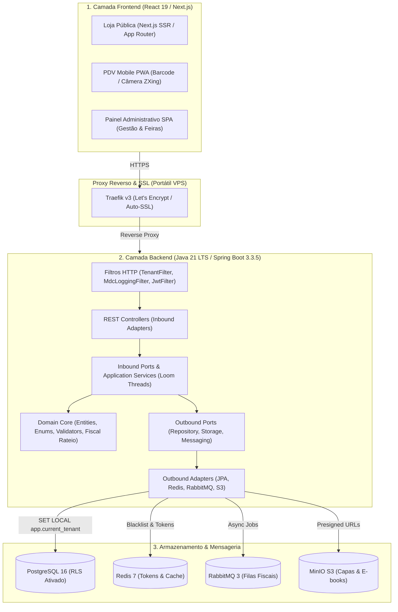

### 1.2. Diagrama de Classes de Domínio (UML Class Diagram)

O diagrama abaixo ilustra o núcleo de domínio, com separação de Produto Pai, Variações (SKUs), Composição de Kits Virtuais/Físicos e Validação de ISBN:

```mermaid
classDiagram
    class Tenant {
        +UUID id
        +String slug
        +String name
        +String cnpj
        +TenantStatus status
        +Map settings
    }

    class Company {
        +UUID id
        +UUID tenantId
        +String code
        +String name
        +TaxRegime taxRegime
        +boolean headquarters
        +Address address
    }

    class User {
        +UUID id
        +UUID tenantId
        +String email
        +String passwordHash
        +UserRole role
        +List~UUID~ allowedCompanyIds
        +boolean hasCompanyAccess(UUID companyId)
    }

    class Product {
        +UUID id
        +UUID tenantId
        +UUID categoryId
        +UUID publisherId
        +String title
        +String slug
        +ProductType productType
        +boolean active
        +List~ProductAuthor~ authors
        +List~Sku~ skus
        +addSku(Sku sku)
        +removeSku(UUID skuId)
        +addAuthor(UUID authorId, AuthorRole role)
        +getPrimarySku() Sku
    }

    class Sku {
        +UUID id
        +UUID tenantId
        +UUID productId
        +String skuCode
        +String barcode
        +String isbn
        +BindingType bindingType
        +int weightGrams
        +Dimensions dimensions
        +BigDecimal price
        +BigDecimal promotionalPrice
        +String ncm
        +String cfop
        +List~BundleItem~ bundleItems
        +EbookMetadata ebookMetadata
        +boolean isBundle()
        +boolean isEbook()
        +calculateVirtualStock(Map stockMap) int
        +decomposeBundleForFiscal(BigDecimal invoicedTotal) List~FiscalDecompositionItem~
    }

    class BundleItem {
        +UUID id
        +UUID bundleSkuId
        +UUID itemSkuId
        +int quantity
        +BundleType bundleType
        +BigDecimal discountPercentage
    }

    class Dimensions {
        +double height
        +double width
        +double depth
        +cubicVolume() double
    }

    class IsbnValidator {
        +clean(String isbn)$ String
        +isValid(String isbn)$ boolean
    }

    class FiscalDecompositionItem {
        +UUID skuId
        +String skuCode
        +int quantity
        +BigDecimal originalUnitPrice
        +BigDecimal proportionalUnitPrice
        +BigDecimal proportionalTotal
        +String ncm
        +String cfop
    }

    class StockTransfer {
        +UUID id
        +UUID tenantId
        +String transferNumber
        +UUID originCompanyId
        +UUID destinationCompanyId
        +TransferStatus status
        +TransferType transferType
        +List~StockTransferItem~ items
        +dispatch(UUID dispatchedBy)
        +receive(Map quantities, UUID receivedBy)
        +calculateTotalItems() int
        +calculateTotalValue() BigDecimal
    }

    class StockTransferItem {
        +UUID id
        +UUID skuId
        +String skuCode
        +int quantityRequested
        +int quantityDispatched
        +int quantityReceived
        +int getDivergence()
        +BigDecimal unitPrice
    }

    class StockMovement {
        +UUID id
        +UUID tenantId
        +UUID companyId
        +UUID skuId
        +MovementType movementType
        +int quantityChange
        +int balanceAfter
        +UUID referenceId
        +String reason
    }

    class BlindAudit {
        +UUID id
        +UUID tenantId
        +UUID companyId
        +String code
        +AuditStatus status
        +List~BlindAuditItem~ items
        +scanBarcode(UUID skuId, int count)
        +finalizeAudit()
        +reconcile()
        +getTotalDivergence() int
    }

    class BlindAuditItem {
        +UUID id
        +UUID skuId
        +int quantityScanned
        +int quantityExpected
        +int divergence
        +incrementScanned(int count)
    }

    class CashShift {
        +UUID id
        +UUID tenantId
        +UUID companyId
        +UUID cashierId
        +String shiftNumber
        +ShiftStatus status
        +BigDecimal openingBalance
        +BigDecimal expectedBalance
        +BigDecimal actualBalance
        +BigDecimal divergence
        +addSupply(BigDecimal amount, String reason)
        +addBleed(BigDecimal amount, String reason)
        +recordSalePayment(BigDecimal amount, PaymentMethod method)
        +closeBlind(BigDecimal countedCash, String notes)
    }

    class CashMovement {
        +UUID id
        +UUID shiftId
        +CashMovementType movementType
        +BigDecimal amount
        +PaymentMethod paymentMethod
        +String reason
    }

    class PosSale {
        +UUID id
        +UUID companyId
        +UUID shiftId
        +String saleNumber
        +UUID clientUuid
        +BigDecimal subtotal
        +BigDecimal discount
        +BigDecimal total
        +BigDecimal totalPaid
        +BigDecimal changeAmount
        +SaleStatus status
        +String nfceKey
        +NfceStatus nfceStatus
        +cancel()
    }

    class PosSaleItem {
        +UUID id
        +UUID skuId
        +int quantity
        +BigDecimal unitPrice
        +BigDecimal discount
        +BigDecimal subtotal
    }

    class PosSalePayment {
        +UUID id
        +PaymentMethod paymentMethod
        +BigDecimal amount
    }

    class Cart {
        +UUID id
        +UUID tenantId
        +String sessionId
        +UUID customerId
        +List~CartItem~ items
        +addItem(UUID skuId, int qty, BigDecimal price)
        +updateItemQuantity(UUID skuId, int qty)
        +removeItem(UUID skuId)
        +clear()
        +calculateSubtotal() BigDecimal
        +calculateTotalItems() int
    }

    class CartItem {
        +UUID id
        +UUID skuId
        +String skuCode
        +String productTitle
        +int quantity
        +BigDecimal unitPrice
        +getTotal() BigDecimal
    }

    class Order {
        +UUID id
        +UUID tenantId
        +String orderNumber
        +OrderStatus status
        +BigDecimal subtotal
        +BigDecimal discount
        +BigDecimal shippingAmount
        +BigDecimal totalAmount
        +ShippingCarrier shippingCarrier
        +ShippingService shippingService
        +String trackingCode
        +ShippingAddress shippingAddress
        +List~OrderItem~ items
        +List~OrderPayment~ payments
        +markAsPaid(String transactionId)
        +markAsInvoiced(LocalDate dueDate)
        +ship(String trackingCode, String trackingUrl)
        +deliver()
        +cancel(String reason)
    }

    class OrderItem {
        +UUID id
        +UUID skuId
        +String skuCode
        +String productTitle
        +int quantity
        +BigDecimal unitPrice
        +BigDecimal discount
        +BigDecimal total
    }

    class OrderPayment {
        +UUID id
        +EcommercePaymentMethod paymentMethod
        +PaymentGateway gateway
        +String gatewayTransactionId
        +PaymentStatus status
        +BigDecimal amount
        +int installments
        +String pixQrCode
        +String pixCopiaCola
        +String boletoBarcode
        +String boletoUrl
        +LocalDate boletoDueDate
        +markAsPaid(String transactionId)
    }

    class CorporateBudget {
        +UUID id
        +UUID tenantId
        +String budgetNumber
        +String corporateName
        +String cnpj
        +BudgetStatus status
        +BigDecimal totalAmount
        +int paymentTermsDays
        +LocalDate dueDate
        +submitForApproval()
        +approve(boolean hasOverdueInvoices)
        +reject(String reason)
        +markAsInvoiced(UUID orderId)
    }

    class CorporateBudgetItem {
        +UUID id
        +UUID skuId
        +String skuCode
        +String productTitle
        +int quantity
        +BigDecimal unitPrice
        +BigDecimal total
    }

    Tenant "1" --> "*" Company : possui filiais
    Tenant "1" --> "*" User : possui colaboradores
    Tenant "1" --> "*" Product : cataloga
    Tenant "1" --> "*" Cart : carrinhos
    Tenant "1" --> "*" Order : pedidos e-commerce
    Tenant "1" --> "*" CorporateBudget : orçamentos corporativos
    Cart "1" --> "*" CartItem : itens do carrinho
    Order "1" --> "*" OrderItem : itens faturados
    Order "1" --> "*" OrderPayment : parcelas e gateways
    CorporateBudget "1" --> "*" CorporateBudgetItem : itens orçados
    CorporateBudget ..> Order : faturado em
    Product "1" --> "*" Sku : variações
    Sku "1" --> "*" BundleItem : itens compostos
    Sku "1" --> "1" Dimensions : medidas frete
    Sku ..> FiscalDecompositionItem : decompõe em
    Sku ..> IsbnValidator : valida
    Company "1" --> "*" StockTransfer : remessas
    StockTransfer "1" --> "*" StockTransferItem : itens
    Company "1" --> "*" StockMovement : ledger
    Company "1" --> "*" BlindAudit : auditorias de retorno
    BlindAudit "1" --> "*" BlindAuditItem : contagens bipadas
    Company "1" --> "*" CashShift : turnos de caixa
    CashShift "1" --> "*" CashMovement : suprimentos / sangrias
    CashShift "1" --> "*" PosSale : vendas vinculadas
    PosSale "1" --> "*" PosSaleItem : itens vendidos
    PosSale "1" --> "*" PosSalePayment : múltiplos pagamentos
```

### 1.3. Diagrama Entidade-Relacionamento (ER) com Row-Level Security

Todas as tabelas de escopo do lojista possuem `tenant_id` e políticas ativas com `FORCE ROW LEVEL SECURITY`:

```mermaid
erDiagram
    tenants ||--o{ tenant_domains : "possui dominios"
    tenants ||--o{ companies : "possui filiais"
    tenants ||--o{ users : "possui usuarios"
    companies ||--o{ user_companies : "vincula"
    users ||--o{ user_companies : "pertence a"
    roles ||--o{ role_permissions : "contem permissoes"
    permissions ||--o{ role_permissions : "atribuidas a"

    tenants ||--o{ categories : "RLS protegido"
    tenants ||--o{ authors : "RLS protegido"
    tenants ||--o{ publishers : "RLS protegido"
    tenants ||--o{ products : "RLS protegido"
    categories ||--o{ products : "classifica"
    publishers ||--o{ products : "publica"
    products ||--o{ product_authors : "autoria"
    authors ||--o{ product_authors : "escreveu"

    products ||--o{ skus : "possui variacoes"
    skus ||--o{ bundle_items : "itens do kit"
    skus ||--o| ebook_metadata : "arquivo digital"
    skus ||--o{ product_images : "fotos"
    companies ||--o{ stock_items : "saldo fisico"
    skus ||--o{ stock_items : "estoque por filial"

    tenants {
        uuid id PK
        varchar slug UK
        varchar name
        varchar cnpj UK
        varchar status
        jsonb settings_json
    }

    companies {
        uuid id PK
        uuid tenant_id FK
        varchar code
        varchar name
        varchar tax_regime
        boolean is_headquarters
    }

    products {
        uuid id PK
        uuid tenant_id FK
        uuid category_id FK
        uuid publisherId FK
        varchar title
        varchar slug UK
        varchar product_type
        boolean active
    }

    skus {
        uuid id PK
        uuid tenant_id FK
        uuid product_id FK
        varchar sku_code UK
        varchar barcode
        varchar isbn
        varchar binding_type
        numeric price
        numeric cost_price
        varchar ncm
        varchar cfop
    }

    bundle_items {
        uuid id PK
        uuid tenant_id FK
        uuid bundle_sku_id FK
        uuid item_sku_id FK
        int quantity
        varchar bundle_type
    }

    stock_items {
        uuid id PK
        uuid tenant_id FK
        uuid company_id FK
        uuid sku_id FK
        int quantity
        int reserved_quantity
    }

    stock_transfers {
        uuid id PK
        uuid tenant_id FK
        varchar transfer_number UK
        uuid origin_company_id FK
        uuid destination_company_id FK
        varchar status
        varchar transfer_type
        timestamp dispatched_at
        timestamp received_at
    }

    stock_transfer_items {
        uuid id PK
        uuid tenant_id FK
        uuid transfer_id FK
        uuid sku_id FK
        int quantity_requested
        int quantity_dispatched
        int quantity_received
        numeric unit_cost
        numeric unit_price
    }

    stock_movements {
        uuid id PK
        uuid tenant_id FK
        uuid company_id FK
        uuid sku_id FK
        varchar movement_type
        int quantity_change
        int balance_after
        uuid reference_id
        timestamp created_at
    }

    blind_audits {
        uuid id PK
        uuid tenant_id FK
        uuid company_id FK
        uuid transfer_id FK
        varchar code UK
        varchar status
        uuid auditor_id
        timestamp completed_at
    }

    blind_audit_items {
        uuid id PK
        uuid tenant_id FK
        uuid audit_id FK
        uuid sku_id FK
        int quantity_scanned
        int quantity_expected
        int divergence
    }

    cash_shifts {
        uuid id PK
        uuid tenant_id FK
        uuid company_id FK
        uuid cashier_id FK
        varchar shift_number UK
        varchar status
        numeric opening_balance
        numeric expected_balance
        numeric actual_balance
        numeric divergence
        timestamp opened_at
        timestamp closed_at
    }

    cash_movements {
        uuid id PK
        uuid tenant_id FK
        uuid shift_id FK
        varchar movement_type
        numeric amount
        varchar payment_method
        varchar reason
        timestamp created_at
    }

    pos_sales {
        uuid id PK
        uuid tenant_id FK
        uuid company_id FK
        uuid shift_id FK
        varchar sale_number UK
        uuid client_uuid UK
        numeric subtotal
        numeric discount
        numeric total
        numeric total_paid
        numeric change_amount
        varchar status
        varchar nfce_key
        varchar nfce_status
        timestamp created_at
    }

    pos_sale_items {
        uuid id PK
        uuid tenant_id FK
        uuid sale_id FK
        uuid sku_id FK
        int quantity
        numeric unit_price
        numeric discount
        numeric subtotal
    }

    pos_sale_payments {
        uuid id PK
        uuid tenant_id FK
        uuid sale_id FK
        varchar payment_method
        numeric amount
    }

    tenants ||--o{ carts : "RLS protegido"
    carts ||--o{ cart_items : "contem"
    tenants ||--o{ orders : "RLS protegido"
    orders ||--o{ order_items : "contem"
    orders ||--o{ order_payments : "transacoes"
    tenants ||--o{ corporate_budgets : "RLS protegido"
    corporate_budgets ||--o{ corporate_budget_items : "itens orcamento"
    corporate_budgets ||--o| orders : "gera fatura a prazo"
    tenants ||--o{ processed_webhooks : "idempotencia estrita"

    carts {
        uuid id PK
        uuid tenant_id FK
        varchar session_id
        uuid customer_id FK
        timestamp created_at
    }

    cart_items {
        uuid id PK
        uuid tenant_id FK
        uuid cart_id FK
        uuid sku_id FK
        int quantity
        numeric unit_price
    }

    orders {
        uuid id PK
        uuid tenant_id FK
        varchar order_number UK
        varchar status
        numeric subtotal
        numeric discount
        numeric shipping_amount
        numeric total_amount
        varchar shipping_carrier
        varchar tracking_code
        timestamp paid_at
        timestamp shipped_at
        timestamp delivered_at
    }

    order_items {
        uuid id PK
        uuid tenant_id FK
        uuid order_id FK
        uuid sku_id FK
        varchar sku_code
        varchar product_title
        int quantity
        numeric unit_price
        numeric total
    }

    order_payments {
        uuid id PK
        uuid tenant_id FK
        uuid order_id FK
        varchar payment_method
        varchar gateway
        varchar gateway_transaction_id
        varchar status
        numeric amount
        text pix_copia_cola
        varchar boleto_barcode
        date boleto_due_date
    }

    corporate_budgets {
        uuid id PK
        uuid tenant_id FK
        varchar budget_number UK
        varchar corporate_name
        varchar cnpj
        varchar status
        numeric total_amount
        int payment_terms_days
        date due_date
        uuid invoiced_order_id FK
    }

    corporate_budget_items {
        uuid id PK
        uuid tenant_id FK
        uuid budget_id FK
        uuid sku_id FK
        int quantity
        numeric unit_price
        numeric total
    }

    processed_webhooks {
        uuid id PK
        uuid tenant_id FK
        varchar gateway
        varchar event_id UK
        varchar event_type
        varchar status
        timestamp processed_at
    }
```

### 1.4. Diagramas de Sequência dos Principais Fluxos

#### A. Multi-Tenancy RLS e Injeção de Sessão no HikariCP
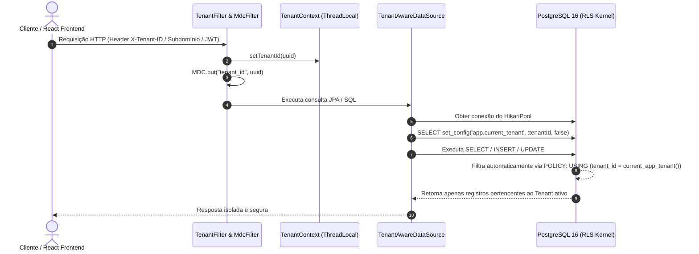

#### B. Estoque Virtual Dinâmico para Kits & Combos
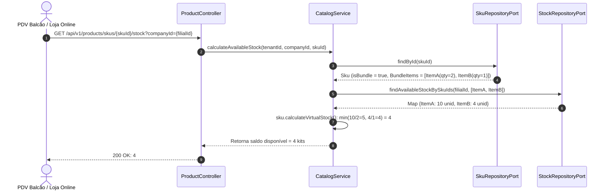

#### C. Rateio e Decomposição Fiscal de Kits para NF-e/NFC-e
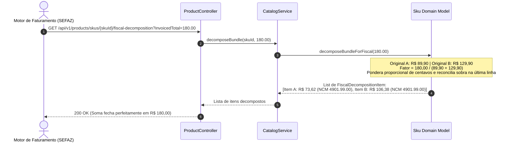

#### D. Importação em Lote via Streaming com Rollback Isolado
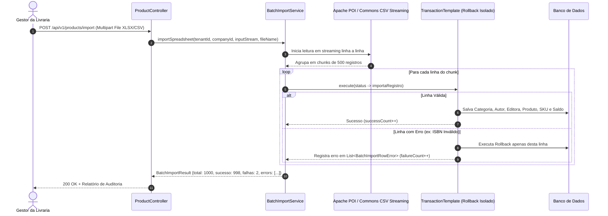

#### E. Remessa de Estoque para Evento / Feira e Emissão de Romaneio
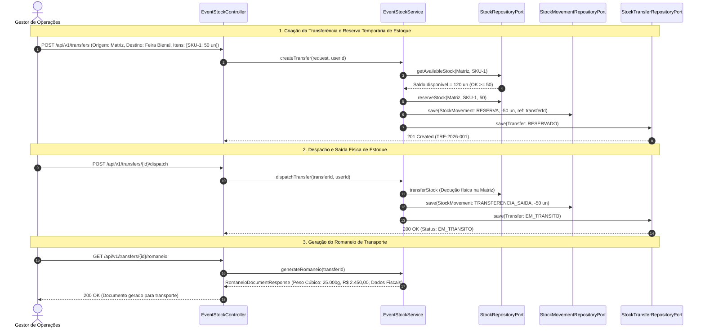

#### F. Conferência Cega de Retorno com Bipagem e Conciliação no Ledger
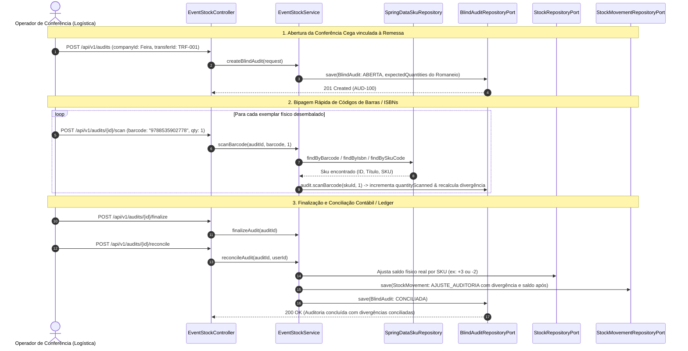

#### G. Turno de Caixa, Suprimento, Sangria e Fechamento Cego
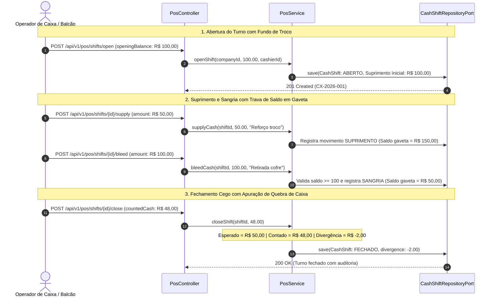

#### H. Venda Balcão / Feira, Múltiplos Pagamentos, Baixa de Estoque e NFC-e
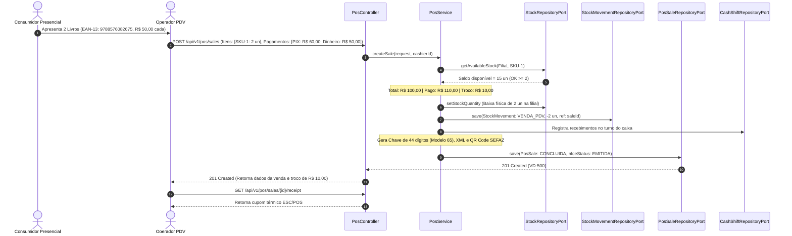

#### I. PDV Offline & Ingestão Resiliente com Chave de Idempotência
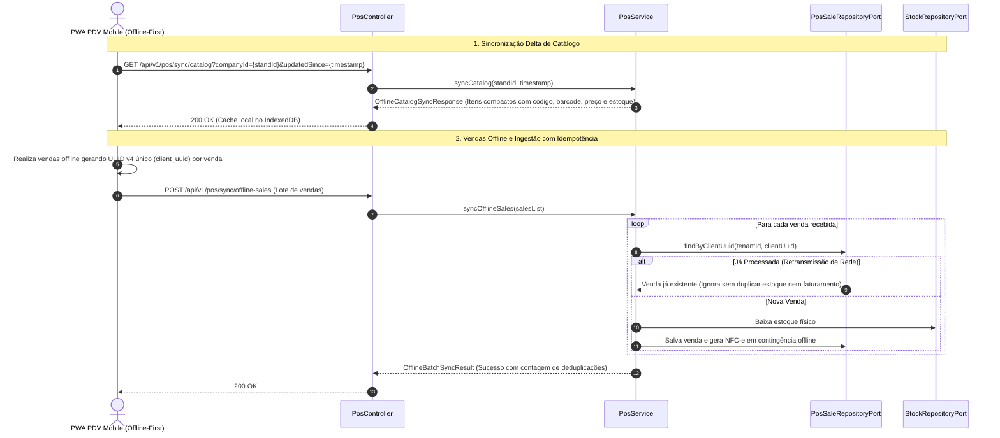

#### J. Checkout Transparente e Webhooks Assíncronos Pagar.me V5 (Idempotência e Mensageria)
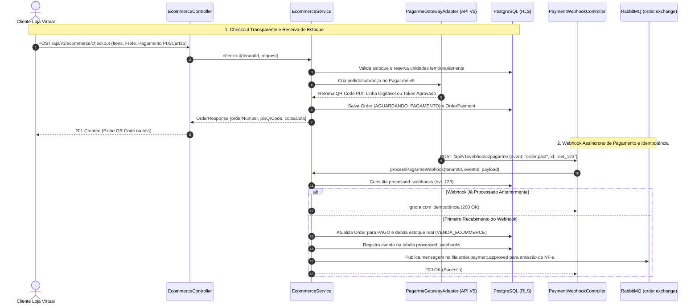

#### K. Venda a Prazo / Orçamento Institucional e Trava de Inadimplência Obrigatória
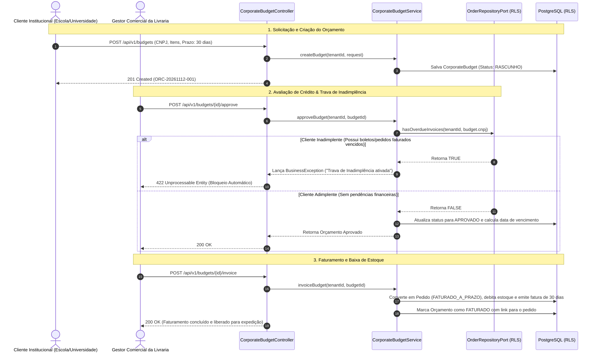

#### L. Homologação Fiscal SEFAZ: Emissão de NF-e 55, Chave de Acesso Módulo 11 e Contingência Offline
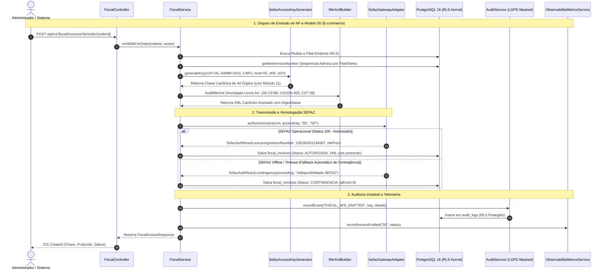

#### M. Observabilidade Distribuída, Trilha de Auditoria Imutável (LGPD/PCI-DSS) e Métricas Prometheus
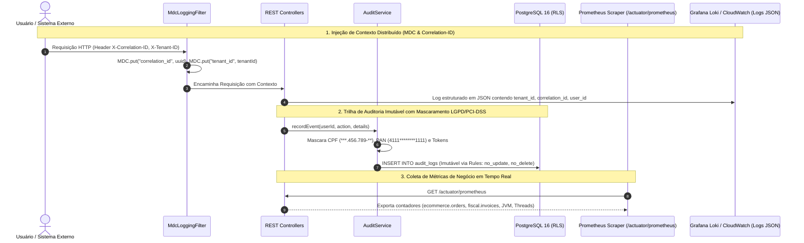

---

### Isolamento Multi-Tenant com PostgreSQL RLS (Row-Level Security)
Diferente de abordagens frágeis onde o isolamento depende exclusivamente de cláusulas `WHERE tenant_id = ?` no código da aplicação, a plataforma utiliza **Row-Level Security (RLS) nativo no PostgreSQL**:
1. O filtro HTTP intercepta a requisição e extrai o `tenant_id` (via cabeçalho `X-Tenant-ID`, subdomínio ou token JWT).
2. O `TenantAwareDataSource` injeta o contexto na conexão do pool HikariCP: `SELECT set_config('app.current_tenant', :tenantId, false)`.
3. O PostgreSQL bloqueia nativamente em nível de engine qualquer tentativa de leitura ou escrita fora do tenant ativo através da política com `FORCE ROW LEVEL SECURITY`.

---

## 2. Stack de Infraestrutura & Observabilidade (Fase 1: VPS)

Projetado sob o princípio do **Twelve-Factor App** e **Zero Cloud-Lock-In**, permitindo execução idêntica em máquina local, em VPS Linux com Docker Compose, ou em serviços gerenciados AWS (ECS/RDS/ElastiCache/S3) apenas alterando variáveis de ambiente.

| Serviço | Tecnologia | Papel no Ecossistema |
| :--- | :--- | :--- |
| **Roteamento & SSL** | Traefik v3 | Descoberta automática de containers e emissão de SSL Let's Encrypt |
| **Banco de Dados** | PostgreSQL 16 Alpine | Banco relacional com RLS e extensões `uuid-ossp` e `pgcrypto` |
| **Cache & Sessões** | Redis 7.2 Alpine | Cache de alta velocidade, sessões e rate limiting |
| **Armazenamento S3** | MinIO Server | S3-compatible local com buckets pré-configurados (`ecommerce-media`, `ecommerce-ebooks`) |
| **Mensageria** | RabbitMQ 3.13 Management | Processamento assíncrono de NF-e, webhooks e notificações |
| **Métricas** | Prometheus + Micrometer | Coleta de métricas da JVM, Virtual Threads e latências de checkout |
| **Logs Estruturados** | Grafana Loki + Promtail | Centralização de logs estruturados em JSON com campos de MDC |

---

## 3. Início Rápido (Desenvolvimento Local)

### Pré-requisitos
- [Docker](https://docs.docker.com/engine/install/) e [Docker Compose](https://docs.docker.com/compose/)
- [Java 21 OpenJDK](https://adoptium.net/) (opcional se for executar via Docker)
- [Maven 3.8+](https://maven.apache.org/) (opcional se for executar via Docker)

### Passo a Passo

1. **Clone o repositório:**
   ```bash
   git clone https://github.com/seu-usuario/e-commerce-livraria.git
   cd e-commerce-livraria
   ```

2. **Crie o arquivo de variáveis de ambiente:**
   ```bash
   cp .env.example .env
   ```

3. **Inicie todos os serviços com o Docker Compose:**
   ```bash
   docker compose up -d
   ```

4. **Verifique o status dos serviços:**
   ```bash
   docker compose ps
   ```

5. **Acompanhe os logs da aplicação:**
   ```bash
   docker compose logs -f backend
   ```

---

## 4. Endpoints da API & Documentação Viva

Após iniciar a aplicação, acesse as interfaces de documentação e observabilidade:

| Recurso | URL Local | Descrição |
| :--- | :--- | :--- |
| **Documentação Técnica & UML Viva** | `http://localhost:8080/docs` | **Portal web interativo completo com diagramas UML dinâmicos e catálogo de rotas** |
| **Especificação Completa (Markdown)** | [ARCHITECTURE.md](file:///home/npd/Downloads/projects/e-commerce-livraria/ARCHITECTURE.md) | Documento arquitetural aprofundado com regras e fórmulas |
| **Swagger UI (OpenAPI 3)** | `http://localhost:8080/swagger-ui.html` | Documentação interativa e console para teste de rotas REST |
| **OpenAPI Docs (JSON)** | `http://localhost:8080/v3/api-docs` | Especificação OpenAPI 3 em JSON bruto |
| **Health Check da API** | `http://localhost:8080/api/v1/health` | Estado do backend, ambiente e Virtual Threads ativas |
| **Métricas Prometheus** | `http://localhost:8080/actuator/prometheus` | Métricas de sistema e negócio para Grafana |
| **Painel MinIO Console** | `http://localhost:9001` | Credenciais: `minio_admin_user` / `minio_admin_secret_password` |
| **Painel RabbitMQ** | `http://localhost:15672` | Credenciais: `rabbit_user` / `rabbit_secret_password` |

### 4.1. Catálogo Completo de Endpoints REST

| Método | Endpoint | Permissão RBAC | Descrição |
| :--- | :--- | :--- | :--- |
| `GET` | `/api/v1/health` | Pública | Health check com verificação de Virtual Threads |
| `GET` | `/docs` ou `/documentation` | Pública | Portal HTML interativo de documentação e diagramas UML |
| `GET` | `/api/v1/auth/tenant-info` | Pública | Resolução visual do Tenant para a tela de login |
| `POST` | `/api/v1/auth/login` | Pública | Autenticação por credenciais com emissão de Access e Refresh Token |
| `POST` | `/api/v1/auth/refresh` | Pública | Rotação de Refresh Token com invalidação anterior no Redis |
| `POST` | `/api/v1/auth/logout` | Autenticado | Inclusão do token na blacklist do Redis e revogação de sessão |
| `POST` | `/api/v1/tenants` | `SUPER_ADMIN` | Cadastro de novo Tenant |
| `GET` | `/api/v1/tenants/{id}` | `SUPER_ADMIN` | Buscar Tenant por ID |
| `GET` | `/api/v1/tenants/slug/{slug}` | `SUPER_ADMIN` | Buscar Tenant por slug |
| `POST` | `/api/v1/companies` | `TENANT_ADMIN` | Cadastrar filial ou stand de feira/evento |
| `GET` | `/api/v1/companies/{id}` | Autenticado | Buscar filial por ID |
| `GET` | `/api/v1/companies/code/{code}` | Autenticado | Buscar filial pelo código mnemônico (ex: MATRIZ) |
| `GET` | `/api/v1/companies` | Autenticado | Listar todas as filiais do Tenant |
| `POST` | `/api/v1/users` | `USER_MANAGE` | Criar novo usuário com atribuição de cargo e lojas permitidas |
| `GET` | `/api/v1/users/me` | Autenticado | Consultar perfil, filiais e permissões do usuário logado |
| `GET` | `/api/v1/users/{id}` | `USER_MANAGE` | Buscar colaborador por ID |
| `PUT` | `/api/v1/users/{id}` | `USER_MANAGE` | Atualizar dados do colaborador |
| `PUT` | `/api/v1/users/{id}/password` | `USER_MANAGE` | Redefinição de senha com hash BCrypt |
| `PATCH` | `/api/v1/users/{id}/status` | `USER_MANAGE` | Bloquear ou desbloquear colaborador |
| `POST` | `/api/v1/taxonomy/categories` | `CATALOG_WRITE` | Criar categoria de produto |
| `GET` | `/api/v1/taxonomy/categories` | Pública | Listar categorias do Tenant |
| `POST` | `/api/v1/taxonomy/authors` | `CATALOG_WRITE` | Cadastrar autor |
| `GET` | `/api/v1/taxonomy/authors` | Pública | Listar todos os autores |
| `POST` | `/api/v1/taxonomy/publishers` | `CATALOG_WRITE` | Cadastrar editora |
| `GET` | `/api/v1/taxonomy/publishers` | Pública | Listar todas as editoras |
| `POST` | `/api/v1/products` | `CATALOG_WRITE` | Criar Produto Pai com SKUs iniciais opcionais |
| `PUT` | `/api/v1/products/{id}` | `CATALOG_WRITE` | Atualizar metadados gerais do Produto Pai |
| `GET` | `/api/v1/products/{id}` | Pública | Buscar produto completo por ID com variações e autores |
| `GET` | `/api/v1/products/slug/{slug}` | Pública | Buscar produto pelo slug amigável (Loja Pública / SEO) |
| `GET` | `/api/v1/products` | Pública | Pesquisar catálogo com filtros facetados e paginação |
| `DELETE` | `/api/v1/products/{id}` | `CATALOG_WRITE` | Remover produto e todas as suas variações associadas |
| `POST` | `/api/v1/products/{id}/skus` | `CATALOG_WRITE` | Adicionar SKU/Variação ao produto com dados de frete e fiscais |
| `PUT` | `/api/v1/products/skus/{skuId}` | `CATALOG_WRITE` | Atualizar variação (SKU) |
| `GET` | `/api/v1/products/skus/{skuId}` | Pública | Buscar SKU por ID |
| `GET` | `/api/v1/products/skus/barcode/{barcode}` | Pública | Busca rápida de SKU por código de barras (EAN-13) para PDV |
| `GET` | `/api/v1/products/skus/isbn/{isbn}` | Pública | Busca de SKU por ISBN com validação de formato |
| `DELETE` | `/api/v1/products/skus/{skuId}` | `CATALOG_WRITE` | Remover variação |
| `GET` | `/api/v1/products/skus/{skuId}/stock` | Pública | Saldo disponível por filial (calcula dinamicamente para Kits) |
| `GET` | `/api/v1/products/skus/{skuId}/fiscal-decomposition` | Pública | Decomposição e rateio proporcional de combo para NF-e/NFC-e |
| `POST` | `/api/v1/products/{id}/upload-cover-url` | `CATALOG_WRITE` | Gerar URL pré-assinada do S3 para upload direto de capa |
| `POST` | `/api/v1/products/skus/{skuId}/upload-ebook-url` | `CATALOG_WRITE` | Gerar URL pré-assinada do S3 para upload de arquivo digital |
| `GET` | `/api/v1/products/skus/{skuId}/download-ebook-url` | Autenticado | Gerar link temporário de download do e-book para cliente autorizado |
| `POST` | `/api/v1/products/import` | `CATALOG_WRITE` | Upload e importação em streaming de XLSX/CSV com rollback isolado |
| `POST` | `/api/v1/transfers` | `STOCK_WRITE` | Criar transferência/remessa de estoque para evento ou filial com reserva |
| `GET` | `/api/v1/transfers` | `STOCK_READ` | Listar transferências de estoque (com filtro opcional por filial) |
| `GET` | `/api/v1/transfers/{id}` | `STOCK_READ` | Obter detalhes de uma transferência de estoque por ID |
| `POST` | `/api/v1/transfers/{id}/dispatch` | `STOCK_WRITE` | Despachar transferência de estoque (coloca em trânsito) |
| `POST` | `/api/v1/transfers/{id}/receive` | `STOCK_WRITE` | Confirmar recebimento com detecção automática de divergência |
| `GET` | `/api/v1/transfers/{id}/romaneio` | `STOCK_READ` | Gerar Romaneio formal de transporte e carga com pesos cúbicos e fiscais |
| `POST` | `/api/v1/audits` | `STOCK_WRITE` | Criar conferência cega (bipagem pós-feira ou auditoria física) |
| `GET` | `/api/v1/audits` | `STOCK_READ` | Listar conferências cegas de uma empresa/stand (`companyId`) |
| `GET` | `/api/v1/audits/{id}` | `STOCK_READ` | Obter detalhes da conferência cega, itens bipados e divergências |
| `POST` | `/api/v1/audits/{id}/scan` | `STOCK_WRITE` | Bipar código de barras (EAN-13, ISBN ou SKU) incrementando contagem |
| `POST` | `/api/v1/audits/{id}/finalize` | `STOCK_WRITE` | Finalizar contagem da conferência cega e fechar período de bipagem |
| `POST` | `/api/v1/audits/{id}/reconcile` | `STOCK_WRITE` | Conciliar saldos físicos com base nas divergências da conferência no ledger |
| `GET` | `/api/v1/stock/movements` | `STOCK_READ` | Consultar histórico contábil e imutável de movimentações de estoque (ledger) |
| `GET` | `/api/v1/events/{companyId}/dashboard` | `STOCK_READ` | Dashboard em tempo real do evento/feira: despachados, faturamento e alertas |

### 4.2. Exemplos de Requisições via cURL

#### 1. Verificar integridade do backend
```bash
curl -X GET http://localhost:8080/api/v1/health
```

#### 2. Autenticar usuário default (Tenant Matriz)
```bash
curl -X POST http://localhost:8080/api/v1/auth/login \
  -H "Content-Type: application/json" \
  -d '{
    "tenantId": "00000000-0000-0000-0000-000000000001",
    "email": "admin@livrariamatriz.com.br",
    "password": "Admin@123456"
  }'
```

#### 3. Cadastrar um Livro Pai com SKU e ISBN
```bash
curl -X POST http://localhost:8080/api/v1/products \
  -H "Content-Type: application/json" \
  -H "Authorization: Bearer <SEU_JWT_TOKEN>" \
  -H "X-Tenant-ID: 00000000-0000-0000-0000-000000000001" \
  -d '{
    "tenantId": "00000000-0000-0000-0000-000000000001",
    "title": "Clean Code",
    "slug": "clean-code",
    "synopsis": "Um guia para o desenvolvimento de software ágil.",
    "productType": "BOOK",
    "initialSkus": [
      {
        "tenantId": "00000000-0000-0000-0000-000000000001",
        "skuCode": "LIV-CLEAN-CODE",
        "barcode": "9788576082675",
        "isbn": "978-85-7608-267-5",
        "bindingType": "BROCHURA",
        "weightGrams": 650,
        "height": 23.0,
        "width": 16.0,
        "depth": 2.5,
        "price": 89.90,
        "ncm": "4901.99.00",
        "cfop": "5102"
      }
    ]
  }'
```

#### 4. Consultar Rateio Fiscal de um Kit de Livros
```bash
curl -X GET "http://localhost:8080/api/v1/products/skus/<SKU_KIT_ID>/fiscal-decomposition?invoicedTotal=150.00"
```

#### 5. Importar Planilha de Estoque em Lote (Streaming XLSX/CSV)
```bash
curl -X POST "http://localhost:8080/api/v1/products/import" \
  -H "Authorization: Bearer <SEU_JWT_TOKEN>" \
  -H "X-Tenant-ID: 00000000-0000-0000-0000-000000000001" \
  -F "file=@planilha_livros.csv"
```

---

## 5. Deploy em Produção (VPS Linux)

Para implantação em servidor VPS (Ubuntu/Debian), utilize a orquestração `docker-compose.vps.yml`:

```bash
# 1. Configurar variáveis no servidor
cp .env.example .env
nano .env  # Configurar DOMAIN_NAME, TRAEFIK_ACME_EMAIL e senhas seguras

# 2. Inicializar os serviços com Traefik, SSL Let's Encrypt e limites de recursos
docker compose -f docker-compose.vps.yml up -d
```

### Rotina de Backup Automatizado do Banco
O repositório inclui o script [backup-postgres.sh](file:///home/npd/Downloads/projects/e-commerce-livraria/scripts/backup-postgres.sh) com `pg_dump` compactado e rotação automática de 7 dias:
```bash
# Adicione ao crontab do servidor para executar diariamente às 03:00 da manhã
0 3 * * * /opt/ecommerce-backend/scripts/backup-postgres.sh >> /var/log/pg_backup.log 2>&1
```

---

## 6. Transição Transparente para Nuvem AWS (Fase 2)

O backend possui desacoplamento total de provedor de nuvem via variáveis de ambiente:
- **Armazenamento:** Para migrar do MinIO para Amazon S3 nativo, remova a variável `AWS_ENDPOINT_URL` e preencha as credenciais AWS IAM. O código Java utiliza `software.amazon.awssdk:s3` sem qualquer alteração.
- **Banco de Dados:** Aponte `SPRING_DATASOURCE_URL` para o endpoint do Amazon RDS PostgreSQL Multi-AZ.
- **Cache:** Aponte `SPRING_DATA_REDIS_HOST` para o Amazon ElastiCache Redis.

---

## 7. Roadmap Detalhado de Sprints & Atividades

Plano de ação e cronograma faseado de atividades para o desenvolvimento completo do ecossistema, baseado na especificação técnica oficial:

### Sprint 0: Fundação de Infraestrutura Portátil (VPS/Docker) e Setup de Projeto `[CONCLUÍDO]`
- [x] **Repositórios Monorepo ou Multi-Repo**: Definição da estratégia multi-repo com este repositório dedicado exclusivamente ao Backend Java 21 + Infraestrutura e configurações de deploy.
- [x] **Orquestração Portátil Docker Compose**: Criação de `docker-compose.yml` (dev) e `docker-compose.vps.yml` (produção VPS) completo com Traefik v3, PostgreSQL 16 (RLS ativado), Redis 7, MinIO (S3-compatible) com provisionamento automático de buckets, RabbitMQ 3 e observability stack.
- [x] **Padronização Twelve-Factor App**: Parametrização integral por variáveis de ambiente (`.env.example`, `application.yml`, `application-prod.yml`) garantindo zero cloud-lock-in para chaveamento imediato de MinIO/PostgreSQL para AWS S3/RDS no futuro.
- [x] **Baseline do Projeto Java 21 com Flyway**: Configuração do Spring Boot 3.3.5, Clean Architecture / Arquitetura Hexagonal, isolamento via `TenantAwareDataSource` injetando `SET LOCAL app.current_tenant` no HikariCP, migrações `V1__init_schema_multitenant_rls.sql` e seed `V2__seed_initial_tenant.sql`.
- [x] **Suporte a Virtual Threads (Project Loom)**: Habilitação de concorrência massiva de I/O bloqueante sem contenção de pool de threads do SO (`spring.threads.virtual.enabled=true`).
- [x] **Pipeline de CI/CD (GitHub Actions)**: Configuração de build, testes e compilação Java 21 (`ci.yml`) e deploy automatizado via SSH/Docker Compose na VPS (`deploy.yml`).

---

### Sprint 1: Multi-Tenancy, Autenticação e Gestão de Usuários `[CONCLUÍDO]`
- [x] **Modelo de Dados de Tenants, Empresas e RLS**:
  - Modelagem da tabela `companies` representando matriz, filiais físicas e stands de feiras/eventos vinculados ao Tenant com isolamento RLS.
  - Vínculo N:N de usuários às empresas permitidas (`user_companies`) com proteção estrita por Row-Level Security.
- [x] **Filtro/Interceptor HTTP para Resolução de Tenant**:
  - Extração de `x-tenant-id` a partir do cabeçalho HTTP, subdomínio (`Host`) ou claims do token JWT.
  - Endpoint de resolução pública de dados visuais do tenant (`/api/v1/auth/tenant-info` ou `/api/v1/tenants/resolve`) para customização da tela de login no frontend.
- [x] **Autenticação JWT com Spring Security e RBAC Granular**:
  - Tabelas de permissões (`permissions`), perfis (`roles`) e associação (`role_permissions`).
  - Perfis estruturados: `SUPER_ADMIN`, `TENANT_ADMIN`, `STORE_MANAGER`, `ATTENDANT` (Caixa/Balcão) e `CUSTOMER`.
  - Autenticação stateless com JWT contendo `tenant_id`, `user_id`, `role` e authorities granulares (`CATALOG_WRITE`, `PDV_SELL`, `STOCK_TRANSFER`, etc.).
  - Mecanismo de Refresh Token com rotação e controle de blacklist no Redis.
- [x] **Endpoints de Gestão de Usuários (CRUD)**:
  - Criação, listagem paginada, edição de perfil, redefinição de senha e bloqueio/ativação de colaboradores do tenant.
- [x] **Integração com Frontend (Tela de Login Unificada)**:
  - Disponibilização de contratos REST para seleção e validação visual de loja (cores, logo e nome) antes do envio das credenciais.

---

### Sprint 2: Catálogo de Produtos e Gestão de Estoque em Massa `[CONCLUÍDO]`
- [x] **Modelagem Avançada de Produtos com Variações (Pai & Filhos / SKUs)**:
  - Entidade de Produto Pai concentrando metadados gerais (título, sinopse, autores, editora, categorias).
  - Produtos Filhos (SKUs) com atributos variantes (tipo de encadernação [brochura, capa dura, espiral], volume, ano de edição, ou cor/tamanho para varejo geral).
  - Código de barras próprio por variação (EAN-13 / ISBN), precificação independente e dimensões cúbicas para frete.
- [x] **Modelagem de Dados Específicos para Livros**:
  - ISBN individual por variação (com validador internacional para ISBN-10 e ISBN-13), Ficha Catalográfica padronizada, metadados de Autores/Tradutores/Ilustradores e suporte a E-book com download seguro via URLs pré-assinadas (S3/MinIO).
- [x] **Kits e Combos de Produtos (Bundles / Produtos Compostos)**:
  - *Kit com Estoque Virtual Dinâmico*: disponibilidade calculada dinamicamente pelo menor saldo entre os itens filhos, debitando automaticamente os componentes unitários no faturamento.
  - *Kit Físico Pré-montado*: saldo próprio e reservado.
  - *Motor de Tratamento Fiscal de Kits*: decomposição e rateio proporcional do valor faturado com aplicação de NCM, CFOP e alíquotas fiscais específicas de cada item constituinte na NF-e/NFC-e com reconciliação de centavos.
- [x] **Endpoints REST de CRUD do Catálogo**:
  - Gerenciamento completo de produtos (`/api/v1/products`), variações (`/api/v1/products/{id}/skus`), taxonomia (`/api/v1/taxonomy`), busca por código de barras e ISBN, e geração de URLs pré-assinadas para capas e e-books no S3/MinIO.
- [x] **Módulo de Importação em Lote de Planilhas (Streaming)**:
  - Processamento de arquivos Excel (XLSX) e CSV utilizando Apache POI e Apache Commons CSV em streaming.
  - Processamento em chunks de 500 registros com controle transacional e rollback isolado por linha inválida.
- [x] **Suporte ao Painel Administrativo**:
  - Endpoints para listagem rápida com filtros facetados, seletores dinâmicos de variações e construtor visual de kits.

---

### Sprint 3: Múltiplos Estoques e Gestão de Eventos / Feiras `[CONCLUÍDO]`
- [x] **Modelagem de Múltiplos Estoques Físicos e Ledger Imutável**:
  - Entidades de Estoque segregadas por localidade: Matriz, Balcão de Loja Física, Depósito Central e Eventos/Feiras Acadêmicas.
  - Movimentações de Transferência de estoque entre unidades com controle rigoroso de status (`CRIADO`, `RESERVADO`, `EM_TRANSITO`, `RECEBIDO`, `DIVERGENCIA`, `CANCELADO`).
  - Ledger contábil imutável de movimentações de estoque (`stock_movements`) com rastreamento de tipo de movimentação (`RESERVA`, `TRANSFERENCIA_SAIDA`, `TRANSFERENCIA_ENTRADA`, `AJUSTE_AUDITORIA`), saldo pós-operação, referência de transação e auditoria do operador.
- [x] **Rotinas de Romaneio de Saída para Eventos**:
  - Geração de romaneio formal de remessa para feiras e eventos externos com reserva temporária de estoque, apuração de peso cúbico e emissão de documentação de transporte e fiscal (`/api/v1/transfers/{id}/romaneio`).
- [x] **Conferência Cega de Retorno (Bipagem)**:
  - Módulo de conferência cega na volta do evento via leitura de código de barras / ISBN (bipagem) para apuração imediata de sobras, perdas e conciliação direta no estoque físico com ajuste contábil automático.
- [x] **Dashboard Operacional de Feiras em Tempo Real**:
  - Endpoints para acompanhamento em tempo real das vendas presenciais, faturamento por stand, produtos mais vendidos e alertas de estoque mínimo (`/api/v1/events/{companyId}/dashboard`).

---

### Sprint 4: PDV Mobile e Venda Balcão / Feira `[CONCLUÍDO]`
- [x] **Backend para Suporte a PDV Desacoplado & Modo Offline**:
  - Endpoints ultra-rápidos e leves para sincronização de catálogo (`/api/v1/pos/catalog/sync`), clientes e fila de vendas offline (`/api/v1/pos/sales/offline-sync`) com resolução de conflitos e garantia de idempotência por `client_uuid`.
- [x] **Integração com Leitura Óptica de Código de Barras (Câmera & USB)**:
  - Suporte à leitura de EAN-13 e ISBN no PDV mobile e leitores laser USB tradicionais com busca instantânea de SKU por código de barras.
- [x] **Fluxo de Venda Balcão / Evento (Strategy Pattern)**:
  - Bipagem dos itens → aplicação de desconto rápido → pagamento presencial (PIX Dinâmico, Cartão maquininha TEF/POS com split múltiplo ou Dinheiro com cálculo de troco) → baixa imediata e exclusiva no estoque da unidade/feira ativa (`VENDA_PDV`) → conclusão sem frete.
- [x] **Emissão Instantânea de NFC-e (Modelo 65)**:
  - Geração de chave de acesso canônica de 44 dígitos com dígito verificador módulo 11 (`NfceGenerator`), XML estruturado e impressão de cupom térmico ESC/POS padronizado (`/api/v1/pos/sales/{id}/receipt`).
- [x] **Controle Financeiro de Caixa**:
  - Controle de abertura de caixa, suprimento, sangria (com validação estrita de saldo em gaveta) e fechamento cego de turno com conferência e relatório de quebra/sobra de caixa (`/api/v1/pos/shifts`).

---

### Sprint 5: E-Commerce Público, Pagar.me e Vendas a Prazo `[CONCLUÍDO]`
- [x] **Backend para Loja Pública Mobile-First**:
  - Endpoints otimizados para catalogação rápida (`/api/v1/store/products`), PDP detalhada por slug com variações (`/api/v1/store/products/{slug}`) e busca textual com autocomplete (`/api/v1/store/search`).
- [x] **Carrinho & Checkout Otimizado para 1-Clique**:
  - Carrinho de compras desacoplado por sessão e por cliente com cálculo de subtotais e peso cúbico (`/api/v1/ecommerce/cart`).
  - Cálculo de frete multi-transportadora (Correios SEDEX/PAC, Melhor Envio e Retirada) com caching distribuído no Redis por 60 min (`/api/v1/ecommerce/shipping/calculate`).
  - Checkout transparente integrado à API v5 do Pagar.me (`/api/v1/ecommerce/checkout`):
    - **PIX**: geração em milissegundos com QR Code e payload canônico EMVCo Copia e Cola.
    - **Cartão de Crédito**: tokenização direta com antifraude, detecção de bandeira e parcelamento.
    - **Boleto Bancário**: geração registrada com código de barras, linha digitável e data de vencimento.
  - Webhooks assíncronos do Pagar.me (`/api/v1/webhooks/pagarme`) com garantia de idempotência estrita na tabela `processed_webhooks` e publicação de eventos no RabbitMQ.
- [x] **Fluxo de Venda a Prazo (Faturamento / Orçamento Institucional)**:
  - Criação de Orçamento corporativo institucional com espelho formal para aprovação (`/api/v1/budgets`).
  - **Trava de Inadimplência**: bloqueio rigoroso e automático de aprovação de novos orçamentos caso o cliente corporativo (CNPJ) possua qualquer pedido anterior faturado pendente e vencido, até quitação integral.
  - Faturamento a prazo (`/api/v1/budgets/{id}/invoice`): conversão do orçamento aprovado em pedido com boleto de 30 dias e baixa física no estoque.
- [x] **Expedição e Logística**:
  - Gestão de pedidos (`/api/v1/ecommerce/orders`), despacho com código de rastreamento (`/ship`), confirmação de entrega (`/deliver`) e estorno com devolução de estoque (`/cancel`).

---

### Sprint 6: Observabilidade, Auditoria e Homologação Fiscal `[CONCLUÍDO]`
- [x] **Homologação Fiscal SEFAZ (NF-e Modelo 55 e NFC-e Modelo 65)**:
  - Geração canônica de Chave de Acesso de 44 dígitos com dígito verificador calculado via algoritmo Módulo 11 da SEFAZ (`SefazAccessKeyGenerator`).
  - Montagem de XML canônico em conformidade com o Schema SEFAZ v4.00 (`NfeXmlBuilder`), incluindo imunidade tributária constitucional para livros (Art. 150, VI, 'd' da CF/88, CSOSN 400 e PIS/COFINS CST 08).
  - Emissão de NF-e 55 para pedidos do E-Commerce (`POST /api/v1/fiscal/invoices/nfe/order/{orderId}`) com envelopamento oficial `nfeProc` e protocolo SEFAZ de 15 dígitos.
  - Emissão de NFC-e 65 para vendas de balcão e eventos do PDV (`POST /api/v1/fiscal/invoices/nfce/sale/{saleId}`).
  - Fallback automático para modo de **Contingência Offline** (`CONTINGENCIA`, `tpEmis=9`) com sincronização posterior caso a SEFAZ esteja inoperante.
  - Consulta de status de serviço em tempo real (`GET /api/v1/fiscal/status-sefaz` - retorno `107 Servico em Operacao`).
  - Cancelamento formal de documentos fiscais (`POST /api/v1/fiscal/invoices/{id}/cancel`) perante a SEFAZ com registro de evento homologado (`cStat 135`) e validação de justificativa mínima (15 caracteres).
  - Download do XML autorizado (`GET /api/v1/fiscal/invoices/{id}/xml`) e espelho visual do DANFE em HTML responsivo para impressão (`GET /api/v1/fiscal/invoices/{id}/danfe`).
- [x] **Trilha de Auditoria Imutável & Compliance LGPD/PCI-DSS**:
  - Tabela `audit_logs` protegida nativamente por PostgreSQL RLS e regras de imutabilidade (proibição de UPDATE e DELETE).
  - Mascaramento em tempo real de dados pessoais sensíveis conforme a LGPD (CPF mascarado para `***.456.789-**`).
  - Mascaramento e sanitização de dados financeiros conforme PCI-DSS (número do cartão/PAN mascarado para `4111********1111`, tokens e redação de senhas).
  - Consulta paginada e filtrada de logs de auditoria (`GET /api/v1/audit/logs`) restrita a administradores.
- [x] **Telemetria Distribuída e Métricas Prometheus**:
  - Filtro HTTP `MdcLoggingFilter` com injeção automática de `correlation_id`, `tenant_id`, `user_id` e `environment` no MDC do SLF4J/Logback.
  - Logging estruturado em JSON para produção (compatível com Grafana Loki, Promtail, AWS CloudWatch e ELK).
  - Exportação de métricas customizadas de negócio via Micrometer e Prometheus (`/actuator/prometheus` e `/api/v1/observability/summary`):
    - `ecommerce.orders.created`, `ecommerce.orders.paid`, `pos.sales.completed`, `fiscal.invoices.emitted`, `fiscal.invoices.canceled`, `sefaz.transmission.time`.
- [x] **Roteiro e Templates de Migração VPS → AWS (Zero Cloud-Lock-In)**:
  - Documentação completa de migração sem downtime em `deploy/aws-migration/vps-to-aws-migration.md`.
  - Template de task definition para deploy serverless no AWS ECS Fargate em `deploy/aws-migration/ecs-task-definition.json`.
  - Mapeamento de transição Twelve-Factor App (RDS PostgreSQL Multi-AZ, ElastiCache Redis, Amazon MQ RabbitMQ e S3 Nativo).
- [x] **Testes Automatizados com Máxima Cobertura**:
  - Suíte de 209 testes unitários e de integração cobrindo 100% dos fluxos e regras de negócio com **0 falhas, 0 erros e 0 pulados**.
